# Dicionário de Dados — MongoDB (`agmrm`)

> **Plataforma Educacional Integrada AGMRM** — Projeto Integrador IV (Engenharia de Software • PUC-Campinas 2026 • **Time 3**)
>
> **Arquivos Formais para Download / Banca:** [Dicionario_de_Dados_MongoDB_AGMRM.pdf](./Dicionario_de_Dados_MongoDB_AGMRM.pdf) | [Dicionario_de_Dados_MongoDB_AGMRM.docx](./Dicionario_de_Dados_MongoDB_AGMRM.docx)

## Equipe (Time 3 — PI-IV)

| RA | Nome Completo | GitHub |
|---|---|---|
| `24802449` | Alex Gabriel Soares Sousa | `@Alekkzsx` |
| `25006702` | Guilherme Henrique Moreira | `@GuilhermeMoreira07` |
| `25015323` | Marcelo Zarpelon | `@zarpela` |
| `25014012` | Murillo Caravita | `@MurilloCaravita` |
| `25009719` | Rafael Henrique Inácio | `@rafaelhenriqueinacio` |

## Visão Executiva do Cluster (`Cluster0 / agmrm`)

- **Banco de Dados:** `agmrm` (MongoDB Atlas — `Cluster0`)
- **Total de Coleções Documentadas:** **34 coleções** (33 existentes ao vivo no cluster + 1 criada sob demanda: `academic_class_chat_messages`)
- **Volume Real Auditado:** **2.296 documentos**
- **Índices Reais Auditados:** **101 índices** (**21 `UNIQUE`**, **9 `TTL`** com `expireAfterSeconds: 0`)
- **Arquitetura Dual:** Escrita segmentada entre **Servidor Java SE (`:8080`)** (Identidade, Sessões, OTP/2FA, VideoCall, Auditoria) e **Backend Acadêmico TypeScript (`:3001`)** (Cursos, Turmas, Matrículas, Notas CONSU, AVA, Secretaria Virtual).

## Diagrama de Domínios e Relacionamentos Lógicos (NoSQL)

```mermaid
flowchart TB
    subgraph AUTH["1. Identidade, Auth & Segurança (7)"]
        auth_users["auth_users (63 docs)"]
        auth_sessions["auth_sessions (TTL)"]
        auth_otps["auth_otps (TTL)"]
        auth_login_limits["auth_login_limits (TTL)"]
        auth_challenges["auth_challenges (TTL)"]
        auth_recovery["auth_recovery (TTL)"]
        auth_revoked_tokens["auth_revoked_tokens (TTL legado)"]
    end
    subgraph ACAD["2. Núcleo Acadêmico & AVA (16)"]
        academic_courses["academic_courses (5 docs)"]
        academic_classes["academic_classes (34 docs)"]
        academic_enrollments["academic_enrollments (595 docs)"]
        academic_class_sessions["academic_class_sessions (100 docs)"]
        academic_materials["academic_materials (116 docs)"]
        academic_assignments["academic_assignments (41 docs)"]
        academic_submissions["academic_submissions (45 docs)"]
        academic_grades["academic_grades (739 docs)"]
        academic_rectifications["academic_rectifications"]
        academic_protocols["academic_protocols (31 docs)"]
        academic_enrollment_declarations["academic_enrollment_declarations (31 docs)"]
        academic_announcements["academic_announcements (32 docs)"]
        academic_calendar["academic_calendar (38 docs)"]
        academic_events["academic_events (1 doc)"]
        academic_forum_topics["academic_forum_topics (85 docs)"]
        academic_class_chat_messages["academic_class_chat_messages (lazy)"]
    end
    subgraph STU["3. Discente & Mensagens (3)"]
        student_notes["student_notes (30 docs)"]
        student_reminders["student_reminders (30 docs)"]
        student_professor_messages["student_professor_messages"]
    end
    subgraph VC["4. VideoCall WebRTC & WS (4)"]
        academic_live_sessions["academic_live_sessions (TTL 8h)"]
        video_call_ws_tickets["video_call_ws_tickets (TTL 60s)"]
        video_call_attendance_logs["video_call_attendance_logs (4 docs)"]
        video_call_chat_messages["video_call_chat_messages"]
    end
    subgraph GOV["5. Governança, Auditoria & E-mail (4)"]
        admin_audit_logs["admin_audit_logs (274 docs)"]
        admin_settings["admin_settings (1 doc)"]
        admin_write_guard["admin_write_guard (1 doc)"]
        email_outbox["email_outbox (TTL 24h)"]
    end
    auth_users -->|"userId"| auth_sessions
    auth_users -->|"studentId / professorId"| academic_enrollments
    auth_users -->|"actorId"| admin_audit_logs
    academic_courses -->|"courseCode"| academic_classes
    academic_classes -->|"classCode"| academic_enrollments
    academic_classes -->|"classCode"| academic_assignments
    academic_classes -->|"classCode"| academic_grades
    academic_classes -->|"classCode"| academic_live_sessions
    academic_assignments -->|"assignmentId"| academic_submissions
    academic_live_sessions -->|"roomCode"| video_call_ws_tickets
    academic_live_sessions -->|"roomCode"| video_call_attendance_logs
```



## Índice Mestre das 34 Coleções

| # | Coleção | Domínio | Ciclo de Vida | Escritor | Docs (Live) | Índices |
|---|---|---|---|---|---:|---:|
| 01 | [`auth_challenges`](#auth_challenges) | Domínio 1 | Efêmera (TTL automático em expiresAt) | Servidor Java (:8080) / Índices compartilhados TS | 0 | 5 |
| 02 | [`auth_login_limits`](#auth_login_limits) | Domínio 1 | Efêmera (TTL automático em expiresAt) | Servidor Java (:8080) | 0 | 3 |
| 03 | [`auth_otps`](#auth_otps) | Domínio 1 | Efêmera (TTL automático em expiresAt) | Servidor Java (:8080) | 0 | 3 |
| 04 | [`auth_recovery`](#auth_recovery) | Domínio 1 | Efêmera (TTL automático em expiresAt) | Índices compartilhados (backend/src/shared/mongo/indexes/auth.indexes.ts) | 0 | 5 |
| 05 | [`auth_revoked_tokens`](#auth_revoked_tokens) | Domínio 1 | Efêmera (TTL automático) — Coleção legada no cluster | Legado (substituída por deleção em auth_sessions + RevogacaoTokens em memória) | 0 | 3 |
| 06 | [`auth_sessions`](#auth_sessions) | Domínio 1 | Efêmera (TTL automático em expiresAt) | Servidor Java (:8080) | 0 | 5 |
| 07 | [`auth_users`](#auth_users) | Domínio 1 | Permanente | Servidor Java (:8080) | 63 | 7 |
| 08 | [`academic_announcements`](#academic_announcements) | Domínio 2 | Permanente | Backend TypeScript (:3001) | 32 | 4 |
| 09 | [`academic_assignments`](#academic_assignments) | Domínio 2 | Permanente | Backend TypeScript (:3001) | 41 | 2 |
| 10 | [`academic_calendar`](#academic_calendar) | Domínio 2 | Permanente | Backend TypeScript (:3001) | 38 | 2 |
| 11 | [`academic_class_chat_messages`](#academic_class_chat_messages) | Domínio 2 | Permanente — Criada sob demanda (lazy no código) | Backend TypeScript (:3001) | 0 | 0 |
| 12 | [`academic_class_sessions`](#academic_class_sessions) | Domínio 2 | Permanente | Backend TypeScript (:3001) | 100 | 4 |
| 13 | [`academic_classes`](#academic_classes) | Domínio 2 | Permanente | Backend TypeScript (:3001) | 34 | 4 |
| 14 | [`academic_courses`](#academic_courses) | Domínio 2 | Permanente | Backend TypeScript (:3001) | 5 | 2 |
| 15 | [`academic_enrollment_declarations`](#academic_enrollment_declarations) | Domínio 2 | Permanente | Backend TypeScript (:3001) | 31 | 2 |
| 16 | [`academic_enrollments`](#academic_enrollments) | Domínio 2 | Permanente | Backend TypeScript (:3001) | 595 | 3 |
| 17 | [`academic_events`](#academic_events) | Domínio 2 | Permanente | Backend TypeScript (:3001) | 1 | 3 |
| 18 | [`academic_forum_topics`](#academic_forum_topics) | Domínio 2 | Permanente | Backend TypeScript (:3001) | 85 | 2 |
| 19 | [`academic_grades`](#academic_grades) | Domínio 2 | Permanente | Backend TypeScript (:3001) | 739 | 3 |
| 20 | [`academic_materials`](#academic_materials) | Domínio 2 | Permanente | Backend TypeScript (:3001) | 116 | 2 |
| 21 | [`academic_protocols`](#academic_protocols) | Domínio 2 | Permanente | Backend TypeScript (:3001) | 31 | 4 |
| 22 | [`academic_rectifications`](#academic_rectifications) | Domínio 2 | Permanente (fila de fluxo administrativo) | Backend TypeScript (:3001) | 0 | 3 |
| 23 | [`academic_submissions`](#academic_submissions) | Domínio 2 | Permanente | Backend TypeScript (:3001) | 45 | 3 |
| 24 | [`student_notes`](#student_notes) | Domínio 3 | Permanente | Backend TypeScript (:3001) | 30 | 1 |
| 25 | [`student_professor_messages`](#student_professor_messages) | Domínio 3 | Permanente | Backend TypeScript (:3001) | 0 | 3 |
| 26 | [`student_reminders`](#student_reminders) | Domínio 3 | Permanente | Backend TypeScript (:3001) | 30 | 1 |
| 27 | [`academic_live_sessions`](#academic_live_sessions) | Domínio 4 | Efêmera (TTL automático — janela de 8 horas) | Servidor Java (:8080) | 0 | 4 |
| 28 | [`video_call_attendance_logs`](#video_call_attendance_logs) | Domínio 4 | Permanente (append-only) | Servidor Java (:8080) | 4 | 3 |
| 29 | [`video_call_chat_messages`](#video_call_chat_messages) | Domínio 4 | Permanente (append-only por sala) | Servidor Java (:8080) — Coleção provisionada no cluster | 0 | 2 |
| 30 | [`video_call_ws_tickets`](#video_call_ws_tickets) | Domínio 4 | Efêmera (TTL automático — 60 segundos, uso único) | Servidor Java (:8080) | 0 | 3 |
| 31 | [`admin_audit_logs`](#admin_audit_logs) | Domínio 5 | Permanente (append-only — retenção LGPD 60 meses) | Compartilhado: Java (:8080) + TypeScript (:3001) | 274 | 4 |
| 32 | [`admin_settings`](#admin_settings) | Domínio 5 | Permanente (Singleton `_id: 'institutional'`) | Backend TypeScript (:3001) | 1 | 1 |
| 33 | [`admin_write_guard`](#admin_write_guard) | Domínio 5 | Permanente (Singleton `_id: 'admin'`) | Compartilhado: Java (:8080) + TypeScript (:3001) | 1 | 1 |
| 34 | [`email_outbox`](#email_outbox) | Domínio 5 | Efêmera (TTL automático — 24 horas) | Compartilhado: Java (CanalOutboxLocal) + TypeScript (LocalOutboxEmailProvider) | 0 | 4 |

## Políticas Automáticas de Expiração (9 Índices TTL)

| Coleção | Índice TTL | Chave | `expireAfterSeconds` | Janela |
|---|---|---|---:|---|
| `auth_challenges` | `expiresAt_1` | `{ expiresAt: 1 }` | `0` | Efêmera (TTL automático em expiresAt) |
| `auth_login_limits` | `expiresAt_1` | `{ expiresAt: 1 }` | `0` | Efêmera (TTL automático em expiresAt) |
| `auth_otps` | `idx_auth_otps_expiresat` | `{ expiresAt: 1 }` | `0` | Efêmera (TTL automático em expiresAt) |
| `auth_recovery` | `expiresAt_1` | `{ expiresAt: 1 }` | `0` | Efêmera (TTL automático em expiresAt) |
| `auth_revoked_tokens` | `expiresAt_1` | `{ expiresAt: 1 }` | `0` | Efêmera (TTL automático) — Coleção legada no cluster |
| `auth_sessions` | `expiresAt_1` | `{ expiresAt: 1 }` | `0` | Efêmera (TTL automático em expiresAt) |
| `academic_live_sessions` | `expiresAt_1` | `{ expiresAt: 1 }` | `0` | Efêmera (TTL automático — janela de 8 horas) |
| `video_call_ws_tickets` | `expiresAt_1` | `{ expiresAt: 1 }` | `0` | Efêmera (TTL automático — 60 segundos, uso único) |
| `email_outbox` | `idx_email_outbox_expiresat` | `{ expiresAt: 1 }` | `0` | Efêmera (TTL automático — 24 horas) |

## Dicionário Detalhado por Domínio

### Domínio 1. Identidade, Autenticação e Segurança
*Propriedade: Servidor Java (:8080) — leitura compartilhada com TS (:3001)*

#### auth_challenges

- **Propósito:** Armazena desafios efêmeros de autenticação em dois fatores identificados por `challengeId` e `tokenDigest` (SHA-256), garantindo unicidade e auto-expiração via índice TTL.
- **Escritor / Consumidores:** Servidor Java (:8080) / Índices compartilhados TS | Fluxos de desafio 2FA e tokens temporários de autenticação
- **Ciclo de Vida & Chaves:** Efêmera (TTL automático em expiresAt) | `_id` (ObjectId); chaves `UNIQUE` em `tokenDigest` e `challengeId`, índice em `userId` e índice `TTL` em `expiresAt`.
- **Snapshot Atlas:** `0` documentos | `5` índices

| Campo | Tipo BSON | Obrigatório | Restrições / Ref. | Descrição |
|---|---|---|---|---|
| `_id` | `ObjectId` | Sim | PK automática | Identificador primário do desafio. |
| `challengeId` | `String` | Sim | UNIQUE (UUID) | Identificador público do desafio de 2FA. |
| `tokenDigest` | `String` | Sim | UNIQUE (SHA-256 hex) | Digest criptográfico do token de desafio. |
| `userId` | `String` | Sim | Ref -> auth_users._id | Conta associada ao desafio pendente. |
| `expiresAt` | `Date` | Sim | TTL (expireAfterSeconds: 0) | Instante de expiração automática do desafio. |
| `createdAt` | `Date` | Sim | ISODate (UTC) | Data/hora de emissão do desafio. |

**Índices Auditados no Cluster:**

| Nome | Chave | Propriedades |
|---|---|---|
| `_id_` | `{ _id: 1 }` | PK Padrão (Único) |
| `tokenDigest_1` | `{ tokenDigest: 1 }` | UNIQUE |
| `expiresAt_1` | `{ expiresAt: 1 }` | TTL (0s) |
| `challengeId_1` | `{ challengeId: 1 }` | UNIQUE |
| `userId_1` | `{ userId: 1 }` | Índice secundário de consulta |

#### auth_login_limits

- **Propósito:** Camada durável do limitador progressivo contra força bruta (`LimitadorTentativas`), preservando contagem de falhas e timestamp de lockout (`lockedUntil`) entre reinicializações do servidor (degraus de 30s, 5 min e 30 min).
- **Escritor / Consumidores:** Servidor Java (:8080) | Java (LimitadorTentativas, RepositorioContas)
- **Ciclo de Vida & Chaves:** Efêmera (TTL automático em expiresAt) | `_id` (ObjectId); chave natural `UNIQUE` em `key` (`user:<identidade>`) e índice `TTL` em `expiresAt` (mínimo 10 minutos à frente).
- **Snapshot Atlas:** `0` documentos | `3` índices

| Campo | Tipo BSON | Obrigatório | Restrições / Ref. | Descrição |
|---|---|---|---|---|
| `_id` | `ObjectId` | Sim | PK automática | Identificador primário do registro de limite. |
| `key` | `String` | Sim | UNIQUE (`user:<id>` / `ip:<addr>`) | Chave única identificando a conta ou origem monitorada. |
| `failedAttempts` | `Int32` | Sim | >= 1 | Total acumulado de tentativas inválidas consecutivas na janela. |
| `lockedUntil` | `Date` | Não | ISODate (quando bloqueado) | Instante UTC até o qual novas tentativas retornam HTTP 429 (`Retry-After`). |
| `expiresAt` | `Date` | Sim | TTL (expireAfterSeconds: 0) | Instante de limpeza automática do registro ocioso (mín. 10 min). |
| `updatedAt` | `Date` | Sim | ISODate (UTC) | Última atualização do contador de falhas. |

**Índices Auditados no Cluster:**

| Nome | Chave | Propriedades |
|---|---|---|
| `_id_` | `{ _id: 1 }` | PK Padrão (Único) |
| `key_1` | `{ key: 1 }` | UNIQUE |
| `expiresAt_1` | `{ expiresAt: 1 }` | TTL (0s) |

#### auth_otps

- **Propósito:** Persiste códigos efêmeros de verificação OTP (2FA e recuperação de senha) armazenados exclusivamente como digest `HMAC-SHA256` (`otpHash`), contador atômico de tentativas (`$inc`) e grants de uso único (`RESET_GRANT`, consumidos atomicamente via `findOneAndDelete`).
- **Escritor / Consumidores:** Servidor Java (:8080) | Java (RepositorioOtps, RecoveryHandler, TwoFactorHandler)
- **Ciclo de Vida & Chaves:** Efêmera (TTL automático em expiresAt) | `_id` (ObjectId); índice em `identity` e índice `TTL` (`expireAfterSeconds: 0`) em `expiresAt`.
- **Snapshot Atlas:** `0` documentos | `3` índices

| Campo | Tipo BSON | Obrigatório | Restrições / Ref. | Descrição |
|---|---|---|---|---|
| `_id` | `ObjectId` | Sim | PK automática | Identificador primário do registro OTP. |
| `identity` | `String` | Sim | Minúsculas (indexado) | Identidade normalizada do titular do código/grant. |
| `otpHash` | `String` | Sim | HMAC-SHA256 / SHA-256 hex | Digest criptográfico do código OTP ou fingerprint do `jti` (no caso de `RESET_GRANT`). |
| `tipo` | `String` | Sim | Enum: 2FA / RECOVERY / RESET_GRANT | Discriminador do fluxo de segurança ao qual o registro pertence. |
| `tentativas` | `Int32` | Sim | Default: 0 ($inc atômico) | Contador de tentativas inválidas para bloqueio após limite (`AUTH_OTP_MAX_ATTEMPTS`). |
| `createdAt` | `Date` | Sim | ISODate (UTC) | Instante de emissão do código OTP. |
| `expiresAt` | `Date` | Sim | TTL (expireAfterSeconds: 0) | Instante de expiração automática do código/grant. |

**Índices Auditados no Cluster:**

| Nome | Chave | Propriedades |
|---|---|---|
| `_id_` | `{ _id: 1 }` | PK Padrão (Único) |
| `idx_auth_otps_identity` | `{ identity: 1 }` | Índice secundário de consulta |
| `idx_auth_otps_expiresat` | `{ expiresAt: 1 }` | TTL (0s) |

<details><summary>Exemplo de Documento JSON Sanitizado</summary>

```json
{
  "_id": "ObjectId('67a1b2c3d4e5f60718293c03')",
  "identity": "24802449",
  "otpHash": "<hmac_sha256_hex_64_chars_anonimizado>",
  "tipo": "RECOVERY",
  "tentativas": 0,
  "createdAt": "2026-11-20T18:10:00.000Z",
  "expiresAt": "2026-11-20T18:20:00.000Z"
}
```
</details>

#### auth_recovery

- **Propósito:** Estrutura dedicada ao rastreamento de solicitações ativas de recuperação de senha por `normalizedIdentity`, `email` e `resetTokenHash`, com descarte automático por TTL.
- **Escritor / Consumidores:** Índices compartilhados (backend/src/shared/mongo/indexes/auth.indexes.ts) | Fluxo de recuperação de senha e compatibilidade de tokens de reset
- **Ciclo de Vida & Chaves:** Efêmera (TTL automático em expiresAt) | `_id` (ObjectId); `UNIQUE` em `normalizedIdentity`, índices em `email` e `resetTokenHash`, e índice `TTL` em `expiresAt`.
- **Snapshot Atlas:** `0` documentos | `5` índices

| Campo | Tipo BSON | Obrigatório | Restrições / Ref. | Descrição |
|---|---|---|---|---|
| `_id` | `ObjectId` | Sim | PK automática | Identificador primário do registro de recuperação. |
| `normalizedIdentity` | `String` | Sim | UNIQUE (minúsculas) | Identidade normalizada da conta em fluxo de recuperação. |
| `email` | `String` | Não | Indexado | E-mail destinatário do procedimento de recuperação. |
| `resetTokenHash` | `String` | Não | SHA-256 hex (indexado) | Hash do token de redefinição de senha emitido. |
| `expiresAt` | `Date` | Sim | TTL (expireAfterSeconds: 0) | Expiração automática da janela de recuperação. |
| `createdAt` | `Date` | Sim | ISODate (UTC) | Timestamp de abertura da solicitação. |

**Índices Auditados no Cluster:**

| Nome | Chave | Propriedades |
|---|---|---|
| `_id_` | `{ _id: 1 }` | PK Padrão (Único) |
| `expiresAt_1` | `{ expiresAt: 1 }` | TTL (0s) |
| `normalizedIdentity_1` | `{ normalizedIdentity: 1 }` | UNIQUE |
| `email_1` | `{ email: 1 }` | Índice secundário de consulta |
| `resetTokenHash_1` | `{ resetTokenHash: 1 }` | Índice secundário de consulta |

#### auth_revoked_tokens

- **Propósito:** Blacklist persistida legada de claims `jti` revogados antes da expiração natural do JWT. Na arquitetura atual, a revogação durável ocorre removendo o documento de `auth_sessions` e incrementando `auth_users.sessionVersion`, somada à blacklist rápida em memória `RevogacaoTokens`.
- **Escritor / Consumidores:** Legado (substituída por deleção em auth_sessions + RevogacaoTokens em memória) | Mantida no Atlas por retrocompatibilidade; candidatos à depreciação pós-banca
- **Ciclo de Vida & Chaves:** Efêmera (TTL automático) — Coleção legada no cluster | `_id` (ObjectId); chave `UNIQUE` em `jti` e índice `TTL` (`expireAfterSeconds: 0`) em `expiresAt`.
- **Snapshot Atlas:** `0` documentos | `3` índices

| Campo | Tipo BSON | Obrigatório | Restrições / Ref. | Descrição |
|---|---|---|---|---|
| `_id` | `ObjectId` | Sim | PK automática | Identificador primário do registro. |
| `jti` | `String` | Sim | UNIQUE (JWT ID) | Claim `jti` do token JWT revogado. |
| `expiresAt` | `Date` | Sim | TTL (expireAfterSeconds: 0) | Instante de expiração original do JWT para limpeza automática. |

**Índices Auditados no Cluster:**

| Nome | Chave | Propriedades |
|---|---|---|
| `_id_` | `{ _id: 1 }` | PK Padrão (Único) |
| `jti_1` | `{ jti: 1 }` | UNIQUE |
| `expiresAt_1` | `{ expiresAt: 1 }` | TTL (0s) |

#### auth_sessions

- **Propósito:** Armazena sessões autenticadas ativas vinculadas ao `jti` (`sessionId`) de cada JWT emitido, permitindo revogação imediata por dispositivo (`DELETE`) e conferência autoritativa de sessão (Camada 2 Zero-Trust).
- **Escritor / Consumidores:** Servidor Java (:8080) | Java (RepositorioSessoes, JwtAuthValidator) + TS (jwt-session.middleware, dashboards)
- **Ciclo de Vida & Chaves:** Efêmera (TTL automático em expiresAt) | `_id` (ObjectId); índice `UNIQUE` em `sessionId`, índices em `userId` e `(userId, active)`, e índice `TTL` (`expireAfterSeconds: 0`) em `expiresAt`.
- **Snapshot Atlas:** `0` documentos | `5` índices

| Campo | Tipo BSON | Obrigatório | Restrições / Ref. | Descrição |
|---|---|---|---|---|
| `_id` | `ObjectId` | Sim | PK automática | Identificador primário do documento de sessão. |
| `sessionId` | `String` | Sim | UNIQUE (UUID / JWT jti) | Identificador único da sessão emitido no claim `jti` do token JWT. |
| `userId` | `String` | Sim | Ref -> auth_users._id | ID hexadecimal da conta dona da sessão. |
| `active` | `Boolean` | Sim | Default: true | Flag de estado ativo da sessão (revogação remove o documento). |
| `createdAt` | `Date` | Sim | ISODate (UTC) | Instante de emissão da sessão no login ou refresh. |
| `expiresAt` | `Date` | Sim | TTL (expireAfterSeconds: 0) | Data/hora de expiração do token; MongoDB expurga automaticamente. |
| `userAgent` | `String` | Não | Header User-Agent | Identificação do navegador/dispositivo para a tela 'Dispositivos Conectados'. |
| `ipAddress` | `String` | Não | IPv4 / IPv6 | Endereço IP de origem no momento do login. |

**Índices Auditados no Cluster:**

| Nome | Chave | Propriedades |
|---|---|---|
| `_id_` | `{ _id: 1 }` | PK Padrão (Único) |
| `sessionId_1` | `{ sessionId: 1 }` | UNIQUE |
| `expiresAt_1` | `{ expiresAt: 1 }` | TTL (0s) |
| `userId_1` | `{ userId: 1 }` | Índice secundário de consulta |
| `userId_1_active_1` | `{ userId: 1, active: 1 }` | Índice secundário de consulta |

<details><summary>Exemplo de Documento JSON Sanitizado</summary>

```json
{
  "_id": "ObjectId('67a1b2c3d4e5f60718293b02')",
  "sessionId": "550e8400-e29b-41d4-a716-446655440000",
  "userId": "67a1b2c3d4e5f60718293a01",
  "active": true,
  "userAgent": "Mozilla/5.0 (Flutter Web; Linux x86_64)",
  "ipAddress": "198.51.100.42",
  "createdAt": "2026-11-20T18:00:00.000Z",
  "expiresAt": "2026-11-21T02:00:00.000Z"
}
```
</details>

#### auth_users

- **Propósito:** Repositório central de contas institucionais (discentes, docentes e administradores), credenciais PBKDF2-SHA256 (600.000 iterações) / BCrypt legado, flags de 2FA, versão de sessão (`sessionVersion`) para revogação global, códigos de backup em hash SHA-256 e metadados acadêmicos/LGPD.
- **Escritor / Consumidores:** Servidor Java (:8080) | Java (RepositorioContas, LoginHandler, AdminUserCrudHandler) + TS (jwt-session, dashboards, recipient-guard)
- **Ciclo de Vida & Chaves:** Permanente | `_id` (ObjectId) como PK; chaves naturais únicas em `normalizedIdentity`, `identity`, `ra` e `email` (com `collation` case-insensitive strength=2 e `partialFilterExpression`).
- **Snapshot Atlas:** `63` documentos | `7` índices

| Campo | Tipo BSON | Obrigatório | Restrições / Ref. | Descrição |
|---|---|---|---|---|
| `_id` | `ObjectId` | Sim (100%) | PK imutável (ObjectId ou String fixa) | Identificador primário único do documento no MongoDB. |
| `identity` | `String` | Sim (100%) | Não vazio | Identidade institucional (RA para aluno, login corporativo para docente/admin). |
| `normalizedIdentity` | `String` | Sim (100%) | UNIQUE | Identidade normalizada (`trim().toLowerCase()`) para busca e unicidade case-insensitive. |
| `email` | `String` | Sim (100%) | E-mail válido | Endereço de e-mail institucional cadastrado. |
| `displayName` | `String` | Sim (100%) | String | Nome de exibição do usuário na interface. |
| `profile` | `String` | Sim (100%) | Enum: aluno / docente / admin | Perfil RBAC do usuário no sistema. |
| `passwordHash` | `String` | Sim (100%) | Obrigatório • Sensível | Hash criptográfico da senha (`600000:salt:hash` PBKDF2-SHA256 ou `$2a$` BCrypt legado). Nunca armazenado em texto claro. |
| `active` | `Boolean` | Sim (100%) | Boolean (default: true) | Indica se o registro/conta/sessão está ativo no sistema. |
| `lastLogin` | `Date` | Opcional (17/63) | ISODate / Null | Data/hora UTC do último login bem-sucedido. |
| `lastLoginAt` | `Date` | Opcional (9/63) | ISODate / Null | Alias UTC do último login para compatibilidade entre Java e TS. |
| `normalizedEmail` | `String` | Sim (100%) | Minúsculas | E-mail normalizado em minúsculas para deduplicação e autenticação. |
| `backupCodeDigests` | `Array<String>` | Opcional (1/63) | Array<String> (SHA-256) | Lista de digests SHA-256 de códigos de recuperação 2FA de uso único (consumidos atomicamente via `$pull`). |
| `backupCodesGeneratedAt` | `Date` | Opcional (1/63) | ISODate | Timestamp UTC da última geração do lote de códigos de backup 2FA. |
| `createdAt` | `Date` | Opcional (59/63) | ISODate (UTC) | Data/hora UTC de criação do registro. |
| `seedTag` | `String` | Opcional (59/63) | Opcional (metadado de seed) | Etiqueta de rastreabilidade do módulo de carga inicial/demo (ex.: `agmrm-ecosystem-v1`). |
| `updatedAt` | `Date` | Opcional (60/63) | ISODate (UTC) | Data/hora UTC da última modificação do documento. |
| `department` | `String` | Opcional (13/63) | String | Departamento acadêmico principal (docentes). |
| `greetingPrefix` | `String` | Opcional (13/63) | String | Saudação personalizada exibida no portal docente (`Bem-vindo,` / `Bem-vinda,`). |
| `officeHours` | `Object` | Opcional (13/63) | Embedded Object | Subdocumento embutido com horário de plantão/atendimento do docente. |
| `officeHours.title` | `String` | Opcional (13/63) | String | Título do plantão de atendimento docente. |
| `officeHours.subtitle` | `String` | Opcional (13/63) | String | Descrição curta do horário de atendimento. |
| `officeHours.startTime` | `String` | Opcional (13/63) | HH:mm | Hora de início do atendimento (`HH:mm`). |
| `officeHours.endTime` | `String` | Opcional (13/63) | HH:mm | Hora de término do atendimento (`HH:mm`). |
| `officeHours.location` | `String` | Opcional (13/63) | String | Local físico ou sala virtual do atendimento. |
| `semester` | `String` | Opcional (50/63) | String | Semestre letivo de referência (ex.: `2026/2 - 4º Semestre`). |
| `sessionVersion` | `Int32/Number` | Opcional (55/63) | Int32 >= 0 | Contador monotônico incrementado em troca de senha, alteração de 2FA ou revogação global para invalidar todos os JWTs antigos. |
| `twoFactorRequired` | `Boolean` | Opcional (55/63) | Boolean (default: false) | Indica obrigatoriedade de segundo fator (2FA via OTP) no fluxo de login. |
| `campus` | `String` | Opcional (52/63) | String | Unidade/campus institucional (ex.: `Unidade Sede`). |
| `departmentOrCourse` | `String` | Opcional (52/63) | String | Curso do aluno ou departamento/área do docente e admin. |
| `shift` | `String` | Opcional (37/63) | String | Turno acadêmico (ex.: `Noturno`, `Matutino`). |
| `twoFactorEnabled` | `Boolean` | Opcional (2/63) | Boolean (default: false) | Flag espelho de ativação do 2FA sincronizada com `twoFactorRequired`. |
| `requirePasswordChange` | `Boolean` | Opcional (1/63) | Boolean (default: false) | Quando `true`, bloqueia rotas protegidas com HTTP 403 até a troca obrigatória de senha. |
| `courseCode` | `String` | Opcional (1/63) | Ref -> academic_courses.code | Código identificador do curso superior (ex.: `ES-2026`). |

**Índices Auditados no Cluster:**

| Nome | Chave | Propriedades |
|---|---|---|
| `_id_` | `{ _id: 1 }` | PK Padrão (Único) |
| `normalizedIdentity_1` | `{ normalizedIdentity: 1 }` | UNIQUE |
| `email_1` | `{ email: 1 }` | UNIQUE • Partial: {"email": {"$type": "string"}} • Collation (en, strength=2) |
| `identity_1` | `{ identity: 1 }` | UNIQUE |
| `ra_1` | `{ ra: 1 }` | UNIQUE |
| `profile_1` | `{ profile: 1 }` | Índice secundário de consulta |
| `idx_auth_users_email` | `{ email: 1 }` | Índice secundário de consulta |

<details><summary>Exemplo de Documento JSON Sanitizado</summary>

```json
{
  "_id": "ObjectId('67a1b2c3d4e5f60718293a01')",
  "identity": "24802449",
  "normalizedIdentity": "24802449",
  "displayName": "Discente Exemplo AGMRM",
  "email": "discente.exemplo@aluno.agmrm.edu.br",
  "normalizedEmail": "discente.exemplo@aluno.agmrm.edu.br",
  "profile": "aluno",
  "passwordHash": "600000:<salt_base64_anonimizado>:<hash_pbkdf2_anonimizado>",
  "active": true,
  "twoFactorRequired": false,
  "twoFactorEnabled": false,
  "requirePasswordChange": false,
  "sessionVersion": 3,
  "departmentOrCourse": "Engenharia de Software",
  "semester": "2026/2 - 4º Semestre",
  "shift": "Noturno",
  "campus": "Unidade Sede",
  "createdAt": "2026-08-01T12:00:00.000Z",
  "updatedAt": "2026-11-18T14:30:00.000Z",
  "lastLoginAt": "2026-11-18T14:30:00.000Z"
}
```
</details>

### Domínio 2. Núcleo Acadêmico, Turmas, Avaliações e AVA
*Propriedade: Backend TypeScript (:3001) — ponte interna para Java (:8080)*

#### academic_announcements

- **Propósito:** Mural de comunicados institucionais (Coordenação/Secretaria) e avisos específicos de turma (Docentes), com rastreamento de leitura por discente via array embutido `readBy[]` atualizado com `$addToSet`.
- **Escritor / Consumidores:** Backend TypeScript (:3001) | Admin Announcements Routes, Teacher Communication Service, Student Communications Service
- **Ciclo de Vida & Chaves:** Permanente | `_id` (ObjectId); 3 índices compostos cronológicos `(isInstitutional, createdAt: -1)`, `(classCode, createdAt: -1)` e `(targetStudentId, createdAt: -1)`.
- **Snapshot Atlas:** `32` documentos | `4` índices

| Campo | Tipo BSON | Obrigatório | Restrições / Ref. | Descrição |
|---|---|---|---|---|
| `_id` | `ObjectId` | Sim (100%) | PK imutável (ObjectId ou String fixa) | Identificador primário único do documento no MongoDB. |
| `seedKey` | `String` | Sim (100%) | Opcional (idempotência) | Chave natural idempotente usada em operações de upsert da carga inicial. |
| `audience` | `String` | Sim (100%) | String | Público-alvo textual do comunicado (ex.: `Toda a Comunidade Acadêmica`, `Alunos Matriculados`). |
| `authorName` | `String` | Sim (100%) | String | Nome do autor exibido na publicação. |
| `body` | `String` | Sim (100%) | String | Conteúdo textual principal da mensagem, comunicado ou tópico. |
| `category` | `String` | Sim (100%) | String | Categoria de classificação funcional/visual. |
| `createdAt` | `Date` | Sim (100%) | ISODate (UTC) | Data/hora UTC de criação do registro. |
| `createdBy` | `String` | Sim (100%) | Ref -> auth_users._id | ID (`auth_users._id`) do ator responsável pela criação. |
| `isInstitutional` | `Boolean` | Sim (100%) | Boolean | Diferencia comunicados globais (`true`) de avisos restritos a uma turma (`false`). |
| `priority` | `String` | Sim (100%) | Enum: baixa / normal / alta | Nível de prioridade de exibição/tratamento. |
| `readBy` | `Array<String> / Array<empty>` | Sim (100%) | Array<String> | Array de `studentId`s que já marcaram o comunicado como lido (idempotente via `$addToSet`). |
| `seedTag` | `String` | Sim (100%) | Opcional (metadado de seed) | Etiqueta de rastreabilidade do módulo de carga inicial/demo (ex.: `agmrm-ecosystem-v1`). |
| `title` | `String` | Sim (100%) | String | Título descritivo do item, aula, atividade, aviso ou protocolo. |
| `classCode` | `Null / String` | Opcional (31/32) | Ref -> academic_classes.code | Código identificador da turma acadêmica (ex.: `PI4-2026-4N`). |
| `authorRole` | `String` | Opcional (30/32) | String | Papel institucional do autor (`aluno`, `docente`, `coordenacao`, `secretaria`). |

**Índices Auditados no Cluster:**

| Nome | Chave | Propriedades |
|---|---|---|
| `_id_` | `{ _id: 1 }` | PK Padrão (Único) |
| `isInstitutional_1_createdAt_-1` | `{ isInstitutional: 1, createdAt: -1 }` | Índice secundário de consulta |
| `classCode_1_createdAt_-1` | `{ classCode: 1, createdAt: -1 }` | Índice secundário de consulta |
| `targetStudentId_1_createdAt_-1` | `{ targetStudentId: 1, createdAt: -1 }` | Índice secundário de consulta |

#### academic_assignments

- **Propósito:** Definição de atividades avaliativas, provas, fóruns temáticos e entregas de sprints por turma, incorporando critérios de rubrica (`rubricCriteria[]`) e perguntas/respostas de dúvidas dos alunos (`doubts[]`) diretamente no documento.
- **Escritor / Consumidores:** Backend TypeScript (:3001) | Teacher Assignments Service, Student Delivery Service, Dashboards
- **Ciclo de Vida & Chaves:** Permanente | `_id` (ObjectId); índice composto `(classCode, dueDate: 1)` para agenda de entregas por prazo.
- **Snapshot Atlas:** `41` documentos | `2` índices

| Campo | Tipo BSON | Obrigatório | Restrições / Ref. | Descrição |
|---|---|---|---|---|
| `_id` | `ObjectId` | Sim (100%) | PK imutável (ObjectId ou String fixa) | Identificador primário único do documento no MongoDB. |
| `classCode` | `String` | Sim (100%) | Ref -> academic_classes.code | Código identificador da turma acadêmica (ex.: `PI4-2026-4N`). |
| `seedKey` | `String` | Opcional (40/41) | Opcional (idempotência) | Chave natural idempotente usada em operações de upsert da carga inicial. |
| `allowLateWithPenalty` | `Boolean` | Opcional (39/41) | Boolean | Indica se entregas após `dueDate` são aceitas com penalidade regimental. |
| `createdAt` | `Date` | Sim (100%) | ISODate (UTC) | Data/hora UTC de criação do registro. |
| `createdBy` | `String` | Opcional (39/41) | Ref -> auth_users._id | ID (`auth_users._id`) do ator responsável pela criação. |
| `description` | `String` | Sim (100%) | String | Descrição detalhada do registro. |
| `doubts` | `Array<Object> / Array<empty>` | Opcional (9/41) | Array<Embedded Object> | Subdocumento embutido com dúvidas enviadas por discentes e respostas do docente. |
| `doubts[].id` | `String` | Opcional (5/41) | String | Em `doubts[]`: Atributo `id` do item embutido em `doubts[]`. |
| `doubts[].studentId` | `String` | Opcional (5/41) | Ref -> auth_users._id | Em `doubts[]`: ID (`auth_users._id` em hex) do discente proprietário/vinculado. |
| `doubts[].studentName` | `String` | Opcional (5/41) | String | Em `doubts[]`: Nome completo do discente (snapshot de leitura). |
| `doubts[].question` | `String` | Opcional (5/41) | String | Em `doubts[]`: Atributo `question` do item embutido em `doubts[]`. |
| `doubts[].askedAt` | `Date` | Opcional (5/41) | Date | Em `doubts[]`: Atributo `askedAt` do item embutido em `doubts[]`. |
| `doubts[].reply` | `String` | Opcional (5/41) | String | Em `doubts[]`: Atributo `reply` do item embutido em `doubts[]`. |
| `doubts[].repliedAt` | `Date` | Opcional (5/41) | Date | Em `doubts[]`: Atributo `repliedAt` do item embutido em `doubts[]`. |
| `dueDate` | `Date` | Sim (100%) | ISODate (UTC) | Data/hora limite UTC para entrega ou cumprimento. |
| `dueDateFormatted` | `String` | Opcional (39/41) | String | Prazo formatado (`dd/MM/yyyy`) para exibição rápida. |
| `modality` | `String` | Sim (100%) | Enum: Individual / Equipe | Modalidade de execução da atividade (`Individual` ou `Equipe`). |
| `rubricCriteria` | `Array<Object>` | Opcional (39/41) | Array<Embedded Object> | Subdocumento embutido com critérios avaliativos (`id`, `title`, `maxPoints`, `description`). |
| `rubricCriteria[].id` | `String` | Sim (100%) | String | Em `rubricCriteria[]`: Atributo `id` do item embutido em `rubricCriteria[]`. |
| `rubricCriteria[].title` | `String` | Sim (100%) | String | Em `rubricCriteria[]`: Título descritivo do item, aula, atividade, aviso ou protocolo. |
| `rubricCriteria[].maxPoints` | `Double / Int32/Number` | Sim (100%) | Double / Int32/Number | Em `rubricCriteria[]`: Atributo `maxPoints` do item embutido em `rubricCriteria[]`. |
| `rubricCriteria[].description` | `String` | Sim (100%) | String | Em `rubricCriteria[]`: Descrição detalhada do registro. |
| `seedTag` | `String` | Opcional (40/41) | Opcional (metadado de seed) | Etiqueta de rastreabilidade do módulo de carga inicial/demo (ex.: `agmrm-ecosystem-v1`). |
| `stage` | `String` | Sim (100%) | Enum de etapa | Etapa avaliativa vinculada (ex.: `N1`, `N2`, `P1`, `P2`, `ATIVIDADES`, `PROJETOS`). |
| `title` | `String` | Sim (100%) | String | Título descritivo do item, aula, atividade, aviso ou protocolo. |
| `updatedAt` | `Date` | Opcional (40/41) | ISODate (UTC) | Data/hora UTC da última modificação do documento. |
| `weight` | `Double / Int32/Number` | Sim (100%) | Number > 0 | Peso numérico da avaliação na composição da nota. |
| `isTimelineItem` | `Boolean` | Opcional (7/41) | Boolean | Sinaliza se o registro compõe a linha do tempo acadêmica do AVA. |
| `courseCode` | `String` | Opcional (1/41) | Ref -> academic_courses.code | Código identificador do curso superior (ex.: `ES-2026`). |
| `maxScore` | `Int32/Number` | Opcional (1/41) | Int32 / Double | Pontuação máxima configurável quando distinta da soma padrão. |
| `isUrgent` | `Boolean` | Opcional (31/41) | Boolean | Sinalizador visual de prazo crítico/urgente. |
| `authorName` | `String` | Opcional (1/41) | String | Nome do autor exibido na publicação. |
| `customSubtitle` | `String` | Opcional (2/41) | String | Subtítulo customizado para exibição nos cartões do portal. |
| `dueHour` | `String` | Opcional (31/41) | HH:mm | Horário limite formatado (`HH:mm`, ex.: `23:59`). |
| `moduleTag` | `String` | Opcional (30/41) | String | Identificação do módulo/unidade (ex.: `MÓDULO 1`). |
| `activityType` | `String` | Opcional (30/41) | Enum | Código técnico do tipo (`entrega`, `atividade_pratica`, `avaliacao_parcial`, `forum`). |
| `typeLabel` | `String` | Opcional (30/41) | String | Rótulo legível do tipo de atividade. |
| `rubricCriteria[].criterion` | `String` | Opcional (3/41) | String | Em `rubricCriteria[]`: Atributo `criterion` do item embutido em `rubricCriteria[]`. |
| `rubricCriteria[].maxScore` | `Int32/Number` | Opcional (3/41) | Int32/Number | Em `rubricCriteria[]`: Atributo `maxScore` do item embutido em `rubricCriteria[]`. |

**Índices Auditados no Cluster:**

| Nome | Chave | Propriedades |
|---|---|---|
| `_id_` | `{ _id: 1 }` | PK Padrão (Único) |
| `classCode_1_dueDate_1` | `{ classCode: 1, dueDate: 1 }` | Índice secundário de consulta |

<details><summary>Exemplo de Documento JSON Sanitizado</summary>

```json
{
  "_id": "ObjectId('67a1b2c3d4e5f60718293g01')",
  "classCode": "PI4-2026-4N",
  "title": "Entrega Final — Dicionário de Dados MongoDB & Relatório de Testes",
  "stage": "N2",
  "weight": 5.0,
  "modality": "Equipe",
  "allowLateWithPenalty": true,
  "dueDate": "2026-11-23T23:59:00.000Z",
  "rubricCriteria": [
    {
      "id": "rc-1",
      "title": "Modelagem Documental e Índices",
      "maxPoints": 4.0
    },
    {
      "id": "rc-2",
      "title": "Rigor Técnico e Evidências",
      "maxPoints": 6.0
    }
  ]
}
```
</details>

#### academic_calendar

- **Propósito:** Calendário acadêmico institucional contendo datas letivas, feriados nacionais, janelas de provas A1/A2, prazos de matrícula e datas de bancas integradoras.
- **Escritor / Consumidores:** Backend TypeScript (:3001) | Admin Calendar Routes, Student & Teacher Dashboards
- **Ciclo de Vida & Chaves:** Permanente | `_id` (ObjectId); índice ascendente em `startsAt` para varredura cronológica de agenda.
- **Snapshot Atlas:** `38` documentos | `2` índices

| Campo | Tipo BSON | Obrigatório | Restrições / Ref. | Descrição |
|---|---|---|---|---|
| `_id` | `ObjectId` | Sim (100%) | PK imutável (ObjectId ou String fixa) | Identificador primário único do documento no MongoDB. |
| `seedKey` | `String` | Sim (100%) | Opcional (idempotência) | Chave natural idempotente usada em operações de upsert da carga inicial. |
| `createdAt` | `Date` | Sim (100%) | ISODate (UTC) | Data/hora UTC de criação do registro. |
| `createdBy` | `String` | Sim (100%) | Ref -> auth_users._id | ID (`auth_users._id`) do ator responsável pela criação. |
| `description` | `String` | Sim (100%) | String | Descrição detalhada do registro. |
| `scope` | `String` | Sim (100%) | String | Abrangência do marco do calendário (ex.: `all`). |
| `seedTag` | `String` | Sim (100%) | Opcional (metadado de seed) | Etiqueta de rastreabilidade do módulo de carga inicial/demo (ex.: `agmrm-ecosystem-v1`). |
| `startsAt` | `Date` | Sim (100%) | ISODate (UTC) | Data/hora UTC de início do evento ou aula. |
| `title` | `String` | Sim (100%) | String | Título descritivo do item, aula, atividade, aviso ou protocolo. |
| `type` | `String` | Opcional (3/38) | String | Tipo discriminador do registro ou mídia. |
| `customDateLabel` | `String` | Opcional (3/38) | String | Rótulo visual alternativo para datas especiais. |
| `isMilestone` | `Boolean` | Opcional (3/38) | Boolean | Indica se o evento deve ser destacado como marco principal na timeline. |
| `endsAt` | `Date` | Opcional (1/38) | ISODate (UTC) | Data/hora UTC de término do evento ou aula. |
| `category` | `String` | Opcional (35/38) | Enum | Classificação do evento (`academic`, `administrative`, `exam`, `holiday`, `event`). |

**Índices Auditados no Cluster:**

| Nome | Chave | Propriedades |
|---|---|---|
| `_id_` | `{ _id: 1 }` | PK Padrão (Único) |
| `startsAt_1` | `{ startsAt: 1 }` | Índice secundário de consulta |

#### academic_class_chat_messages

- **Propósito:** Coleção paralela append-only que espelha mensagens publicadas no chat de turma (além do array `academic_classes.chatMessages[]`), garantindo escalabilidade futura sem estourar o limite de 16 MB por documento de turma.
- **Escritor / Consumidores:** Backend TypeScript (:3001) | Student Forum Service (`postClassChatMessage`)
- **Ciclo de Vida & Chaves:** Permanente — Criada sob demanda (lazy no código) | `_id` (ObjectId) automático. Recomendado criar índice composto `{ classCode: 1, createdAt: 1 }` (ver Seção 9).
- **Snapshot Atlas:** `0` documentos | `0` índices

| Campo | Tipo BSON | Obrigatório | Restrições / Ref. | Descrição |
|---|---|---|---|---|
| `_id` | `ObjectId` | Sim | PK automática | Identificador primário da mensagem. |
| `classCode` | `String` | Sim | Ref -> academic_classes.code | Código da turma onde a mensagem foi enviada. |
| `id` | `String` | Sim | UUID v4 | Identificador lógico da mensagem sincronizado com `academic_classes.chatMessages[]`. |
| `authorId` | `String` | Sim | Ref -> auth_users._id | ID do discente remetente. |
| `authorName` | `String` | Sim | String | Nome do remetente. |
| `authorRa` | `String` | Sim | Ref -> auth_users.identity | RA do remetente. |
| `authorRole` | `String` | Sim | Enum: aluno / docente | Papel institucional do remetente. |
| `authorProfile` | `String` | Sim | String | Rótulo de perfil exibido no chat (ex.: `Estudante`). |
| `message` | `String` | Sim | Texto sanitizado | Texto da mensagem enviada. |
| `body` | `String` | Sim | Alias de message | Espelho do texto da mensagem para retrocompatibilidade. |
| `timestamp` | `String` | Sim | Data/hora curta formatada | Carimbo legível para interface. |
| `createdAt` | `String` | Sim | ISO-8601 String | Timestamp UTC da publicação. |

#### academic_class_sessions

- **Propósito:** Diários de aula ministradas ou agendadas de cada turma, contendo conteúdo programático, metodologia, status de homologação e os arrays embutidos de chamada (`attendances[]` e `attendanceList[]` com risco de reprovação por falta).
- **Escritor / Consumidores:** Backend TypeScript (:3001) | Teacher Service (Diário de Classe), Student Dashboard, Internal Bridge (registro automático de presença de VideoCall)
- **Ciclo de Vida & Chaves:** Permanente | `_id` (ObjectId); índice composto `(classCode, startsAt)` para cronologia do diário + 2 índices parciais `UNIQUE` de idempotência para seeds.
- **Snapshot Atlas:** `100` documentos | `4` índices

| Campo | Tipo BSON | Obrigatório | Restrições / Ref. | Descrição |
|---|---|---|---|---|
| `_id` | `ObjectId` | Sim (100%) | PK imutável (ObjectId ou String fixa) | Identificador primário único do documento no MongoDB. |
| `classCode` | `String` | Sim (100%) | Ref -> academic_classes.code | Código identificador da turma acadêmica (ex.: `PI4-2026-4N`). |
| `title` | `String` | Sim (100%) | String | Título descritivo do item, aula, atividade, aviso ou protocolo. |
| `courseCode` | `String` | Sim (100%) | Ref -> academic_courses.code | Código identificador do curso superior (ex.: `ES-2026`). |
| `createdAt` | `Date` | Sim (100%) | ISODate (UTC) | Data/hora UTC de criação do registro. |
| `createdBy` | `String` | Opcional (98/100) | Ref -> auth_users._id | ID (`auth_users._id`) do ator responsável pela criação. |
| `endsAt` | `Date` | Sim (100%) | ISODate (UTC) | Data/hora UTC de término do evento ou aula. |
| `seedTag` | `String` | Opcional (74/100) | Opcional (metadado de seed) | Etiqueta de rastreabilidade do módulo de carga inicial/demo (ex.: `agmrm-ecosystem-v1`). |
| `startsAt` | `Date` | Sim (100%) | ISODate (UTC) | Data/hora UTC de início do evento ou aula. |
| `seedKey` | `String` | Opcional (7/100) | Opcional (idempotência) | Chave natural idempotente usada em operações de upsert da carga inicial. |
| `attendanceList` | `Array<Object> / Array<empty>` | Opcional (68/100) | Array<Embedded Object> | Array embutido detalhado de chamada com status textual, faltas acumuladas e nível de risco. |
| `attendanceList[].studentId` | `String` | Sim (100%) | Ref -> auth_users._id | Em `attendanceList[]`: ID (`auth_users._id` em hex) do discente proprietário/vinculado. |
| `attendanceList[].name` | `String` | Sim (100%) | String | Em `attendanceList[]`: Nome principal da entidade. |
| `attendanceList[].ra` | `String` | Sim (100%) | String / único quando em auth_users | Em `attendanceList[]`: Registro Acadêmico (RA) do discente. |
| `attendanceList[].status` | `String` | Sim (100%) | String / Enum de domínio | Em `attendanceList[]`: Estado atual do ciclo de vida do registro no domínio. |
| `attendanceList[].isConnected` | `Boolean` | Opcional (32/100) | Boolean | Em `attendanceList[]`: Atributo `isConnected` do item embutido em `attendanceList[]`. |
| `cancelled` | `Boolean` | Opcional (33/100) | Boolean | Indica se a aula foi cancelada no calendário. |
| `contentProgram` | `String` | Opcional (68/100) | String | Ementa/conteúdo programático vinculado à sessão. |
| `hours` | `Int32/Number` | Opcional (33/100) | Int32 | Quantidade de horas-aula contabilizadas na sessão. |
| `isHomologated` | `Boolean` | Opcional (34/100) | Boolean | Indica se o registro de presença da aula foi homologado. |
| `location` | `String` | Opcional (97/100) | String | Sala física, laboratório ou link virtual associado. |
| `methodology` | `String` | Opcional (34/100) | String | Estratégia didática da aula (ex.: expositiva, laboratório). |
| `sessionNumber` | `Int32/Number` | Opcional (33/100) | Int32 | Número sequencial da aula no semestre. |
| `attendanceList[].accumulatedAbsences` | `Int32/Number` | Opcional (6/100) | Int32/Number | Em `attendanceList[]`: Atributo `accumulatedAbsences` do item embutido em `attendanceList[]`. |
| `attendanceList[].maxAbsences` | `Int32/Number` | Opcional (6/100) | Int32/Number | Em `attendanceList[]`: Atributo `maxAbsences` do item embutido em `attendanceList[]`. |
| `attendanceList[].attendanceRate` | `Int32/Number` | Opcional (6/100) | Int32/Number | Em `attendanceList[]`: Atributo `attendanceRate` do item embutido em `attendanceList[]`. |
| `attendanceList[].riskLevel` | `String` | Opcional (6/100) | String | Em `attendanceList[]`: Atributo `riskLevel` do item embutido em `attendanceList[]`. |
| `attendanceList[].observation` | `String` | Opcional (1/100) | String | Em `attendanceList[]`: Atributo `observation` do item embutido em `attendanceList[]`. |
| `updatedAt` | `Date` | Opcional (2/100) | ISODate (UTC) | Data/hora UTC da última modificação do documento. |
| `attendances` | `Array<Object>` | Opcional (64/100) | Array<Embedded Object> | Array embutido enxuto de presença binária (`studentId`, `studentIdentity`, `present`). |
| `attendances[].studentId` | `String` | Sim (100%) | Ref -> auth_users._id | Em `attendances[]`: ID (`auth_users._id` em hex) do discente proprietário/vinculado. |
| `attendances[].studentIdentity` | `String` | Sim (100%) | Ref -> auth_users.identity | Em `attendances[]`: RA ou identidade institucional do discente (ex.: `24802449`). |
| `attendances[].present` | `Boolean` | Sim (100%) | Boolean | Em `attendances[]`: Atributo `present` do item embutido em `attendances[]`. |
| `contentTaught` | `String` | Opcional (64/100) | String | Resumo do conteúdo efetivamente ministrado em aula. |
| `status` | `String` | Opcional (64/100) | String / Enum de domínio | Estado atual do ciclo de vida do registro no domínio. |
| `dateFormatted` | `String` | Opcional (1/100) | String | Data da sessão formatada para exibição. |

**Índices Auditados no Cluster:**

| Nome | Chave | Propriedades |
|---|---|---|
| `_id_` | `{ _id: 1 }` | PK Padrão (Único) |
| `classCode_1_startsAt_1` | `{ classCode: 1, startsAt: 1 }` | Índice secundário de consulta |
| `classCode_1_title_1` | `{ classCode: 1, title: 1 }` | UNIQUE • Partial: {"seedTag": "admin-demo-v1"} |
| `student_demo_class_session_unique` | `{ classCode: 1, title: 1 }` | UNIQUE • Partial: {"seedTag": "student-demo-v1"} |

#### academic_classes

- **Propósito:** Entidade central (Agregado Rico) de cada turma/disciplina ofertada no semestre. Combina metadados de horário, docente responsável, lacre/homologação de pauta (`gradeLocked`, `pautaHomologated`, `chancelaCode`) e subdocumentos embutidos de leitura atômica para o AVA (`squads[]`, `syllabusUnits[]`, `bibliography[]`, `chatMessages[]`, `monitors[]`, `recordedSessions[]`).
- **Escritor / Consumidores:** Backend TypeScript (:3001) | Admin, Teacher, Student Dashboards, Internal Bridge (:3001 -> Java :8080)
- **Ciclo de Vida & Chaves:** Permanente | `_id` (ObjectId); chave natural `UNIQUE` em `code`, além de índices em `(professorId, active)` e `courseCode`.
- **Snapshot Atlas:** `34` documentos | `4` índices

| Campo | Tipo BSON | Obrigatório | Restrições / Ref. | Descrição |
|---|---|---|---|---|
| `_id` | `ObjectId` | Sim (100%) | PK imutável (ObjectId ou String fixa) | Identificador primário único do documento no MongoDB. |
| `code` | `String` | Sim (100%) | UNIQUE | Código identificador natural único da entidade no domínio. |
| `courseCode` | `String` | Sim (100%) | Ref -> academic_courses.code | Código identificador do curso superior (ex.: `ES-2026`). |
| `semester` | `String` | Sim (100%) | String | Semestre letivo de referência (ex.: `2026/2 - 4º Semestre`). |
| `shift` | `String` | Sim (100%) | String | Turno acadêmico (ex.: `Noturno`, `Matutino`). |
| `location` | `String` | Sim (100%) | String | Sala física, laboratório ou link virtual associado. |
| `maxCapacity` | `Int32/Number` | Sim (100%) | Int32 (ex.: 50) | Capacidade máxima de vagas na turma. |
| `formulaRegime` | `String` | Sim (100%) | String | Regime de definição da fórmula de avaliação (`autonomia_docente` ou institucional). |
| `courseName` | `String` | Sim (100%) | String | Nome do curso superior associado (desnormalizado para leitura rápida). |
| `professorId` | `String` | Sim (100%) | Ref -> auth_users._id | ID (`auth_users._id` em hex) do docente titular. |
| `professorIdentity` | `String` | Sim (100%) | Ref -> auth_users.identity | Identidade institucional do docente. |
| `createdBy` | `String` | Opcional (33/34) | Ref -> auth_users._id | ID (`auth_users._id`) do ator responsável pela criação. |
| `createdAt` | `Date` | Sim (100%) | ISODate (UTC) | Data/hora UTC de criação do registro. |
| `updatedAt` | `Date` | Sim (100%) | ISODate (UTC) | Data/hora UTC da última modificação do documento. |
| `professorName` | `String` | Sim (100%) | String | Nome de exibição do docente titular. |
| `subjectName` | `String` | Opcional (32/34) | String | Nome da disciplina/componente curricular. |
| `schedule` | `String` | Sim (100%) | String | Descrição textual dos dias e horários de aula. |
| `scheduleDays` | `Array<Int32/Number>` | Opcional (33/34) | Array<Int32> | Lista numérica dos dias da semana com aula (`1`=Seg .. `5`=Sex). |
| `scheduleEndTime` | `String` | Opcional (33/34) | HH:mm | Horário de término da aula (`HH:mm`). |
| `scheduleStartTime` | `String` | Opcional (33/34) | HH:mm | Horário de início da aula (`HH:mm`). |
| `seedTag` | `String` | Opcional (33/34) | Opcional (metadado de seed) | Etiqueta de rastreabilidade do módulo de carga inicial/demo (ex.: `agmrm-ecosystem-v1`). |
| `active` | `Boolean` | Opcional (31/34) | Boolean (default: true) | Indica se o registro/conta/sessão está ativo no sistema. |
| `completedHours` | `Int32/Number` | Opcional (31/34) | Int32 | Carga horária já ministrada até o momento. |
| `evaluationFormula` | `String` | Opcional (7/34) | String | Fórmula específica da turma quando customizada pelo docente. |
| `gradeLocked` | `Boolean` | Opcional (8/34) | Boolean | Indica se o diário de notas está lacrado (exigindo protocolo de retificação). |
| `pautaHomologated` | `Boolean` | Opcional (8/34) | Boolean | Indica se a pauta final da turma foi homologada oficialmente. |
| `squads` | `Array<Object>` | Opcional (7/34) | Array<Embedded Object> | Subdocumento embutido de equipes/squads de projetos integradores da turma. |
| `squads[].id` | `String` | Opcional (14/34) | String | Em `squads[]`: Atributo `id` do item embutido em `squads[]`. |
| `squads[].name` | `String` | Opcional (14/34) | String | Em `squads[]`: Nome principal da entidade. |
| `squads[].projectTitle` | `String` | Opcional (14/34) | String | Em `squads[]`: Atributo `projectTitle` do item embutido em `squads[]`. |
| `squads[].sprintStatus` | `String` | Opcional (14/34) | String | Em `squads[]`: Atributo `sprintStatus` do item embutido em `squads[]`. |
| `squads[].repoUrl` | `String` | Opcional (14/34) | String | Em `squads[]`: Atributo `repoUrl` do item embutido em `squads[]`. |
| `squads[].members` | `Array<String>` | Opcional (14/34) | Array<String> | Em `squads[]`: Atributo `members` do item embutido em `squads[]`. |
| `syllabusUnits` | `Array<Object>` | Opcional (7/34) | Array<Embedded Object> | Unidades programáticas do plano de ensino com tópicos e itens de trilha. |
| `syllabusUnits[].id` | `String` | Opcional (22/34) | String | Em `syllabusUnits[]`: Atributo `id` do item embutido em `syllabusUnits[]`. |
| `syllabusUnits[].unitNumber` | `Int32/Number` | Opcional (22/34) | Int32/Number | Em `syllabusUnits[]`: Atributo `unitNumber` do item embutido em `syllabusUnits[]`. |
| `syllabusUnits[].tag` | `String` | Opcional (22/34) | String | Em `syllabusUnits[]`: Atributo `tag` do item embutido em `syllabusUnits[]`. |
| `syllabusUnits[].title` | `String` | Opcional (22/34) | String | Em `syllabusUnits[]`: Título descritivo do item, aula, atividade, aviso ou protocolo. |
| `syllabusUnits[].topics` | `Array<String>` | Opcional (22/34) | Array<String> | Em `syllabusUnits[]`: Atributo `topics` do item embutido em `syllabusUnits[]`. |
| `syllabusUnits[].hours` | `Int32/Number` | Opcional (22/34) | Int32/Number | Em `syllabusUnits[]`: Atributo `hours` do item embutido em `syllabusUnits[]`. |
| `syllabusUnits[].completedClasses` | `Int32/Number` | Opcional (22/34) | Int32/Number | Em `syllabusUnits[]`: Atributo `completedClasses` do item embutido em `syllabusUnits[]`. |
| `syllabusUnits[].totalClasses` | `Int32/Number` | Opcional (22/34) | Int32/Number | Em `syllabusUnits[]`: Atributo `totalClasses` do item embutido em `syllabusUnits[]`. |
| `syllabusUnits[].items` | `Array<Object>` | Opcional (22/34) | Array<Object> | Em `syllabusUnits[]`: Atributo `items` do item embutido em `syllabusUnits[]`. |
| `syllabusUnits[].items[].id` | `String` | Sim (100%) | String | Em `syllabusUnits[]`: Atributo `items[].id` do item embutido em `syllabusUnits[]`. |
| `syllabusUnits[].items[].type` | `String` | Sim (100%) | String | Em `syllabusUnits[]`: Atributo `items[].type` do item embutido em `syllabusUnits[]`. |
| `syllabusUnits[].items[].title` | `String` | Sim (100%) | String | Em `syllabusUnits[]`: Atributo `items[].title` do item embutido em `syllabusUnits[]`. |
| `syllabusUnits[].items[].subtitle` | `String` | Sim (100%) | String | Em `syllabusUnits[]`: Atributo `items[].subtitle` do item embutido em `syllabusUnits[]`. |
| `syllabusUnits[].items[].actionType` | `String` | Sim (100%) | String | Em `syllabusUnits[]`: Atributo `items[].actionType` do item embutido em `syllabusUnits[]`. |
| `syllabusUnits[].items[].fileName` | `String` | Sim (100%) | String | Em `syllabusUnits[]`: Atributo `items[].fileName` do item embutido em `syllabusUnits[]`. |
| `syllabusUnits[].items[].fileSize` | `String` | Sim (100%) | String | Em `syllabusUnits[]`: Atributo `items[].fileSize` do item embutido em `syllabusUnits[]`. |
| `totalHours` | `Int32/Number` | Opcional (31/34) | Int32 | Carga horária total planejada da disciplina. |
| `bibliography` | `Array<Object>` | Opcional (7/34) | Array<Embedded Object> | Referências bibliográficas básicas e complementares embutidas. |
| `bibliography[].type` | `String` | Opcional (28/34) | String | Em `bibliography[]`: Tipo discriminador do registro ou mídia. |
| `bibliography[].title` | `String` | Opcional (28/34) | String | Em `bibliography[]`: Título descritivo do item, aula, atividade, aviso ou protocolo. |
| `bibliography[].authors` | `String` | Opcional (28/34) | String | Em `bibliography[]`: Atributo `authors` do item embutido em `bibliography[]`. |
| `bibliography[].publisher` | `String` | Opcional (28/34) | String | Em `bibliography[]`: Atributo `publisher` do item embutido em `bibliography[]`. |
| `bibliography[].year` | `String` | Opcional (28/34) | String | Em `bibliography[]`: Atributo `year` do item embutido em `bibliography[]`. |
| `chatMessages` | `Array<Object>` | Opcional (7/34) | Array<Embedded Object> | Histórico embutido de mensagens do chat da turma (espelhado em `academic_class_chat_messages`). |
| `chatMessages[].id` | `String` | Opcional (21/34) | String | Em `chatMessages[]`: Atributo `id` do item embutido em `chatMessages[]`. |
| `chatMessages[].authorName` | `String` | Opcional (21/34) | String | Em `chatMessages[]`: Nome do autor exibido na publicação. |
| `chatMessages[].authorRole` | `String` | Opcional (21/34) | String | Em `chatMessages[]`: Papel institucional do autor (`aluno`, `docente`, `coordenacao`, `secretaria`). |
| `chatMessages[].authorProfile` | `String` | Opcional (21/34) | String | Em `chatMessages[]`: Perfil textual do autor na publicação. |
| `chatMessages[].message` | `String` | Opcional (21/34) | String | Em `chatMessages[]`: Atributo `message` do item embutido em `chatMessages[]`. |
| `chatMessages[].body` | `String` | Opcional (21/34) | String | Em `chatMessages[]`: Conteúdo textual principal da mensagem, comunicado ou tópico. |
| `chatMessages[].timestamp` | `String` | Opcional (21/34) | String | Em `chatMessages[]`: Atributo `timestamp` do item embutido em `chatMessages[]`. |
| `chatMessages[].createdAt` | `String` | Opcional (21/34) | ISODate (UTC) | Em `chatMessages[]`: Data/hora UTC de criação do registro. |
| `credits` | `Int32/Number` | Opcional (31/34) | Int32 | Quantidade de créditos acadêmicos da disciplina. |
| `ementa` | `String` | Opcional (7/34) | String | Texto integral da ementa oficial da disciplina. |
| `methodology` | `String` | Opcional (7/34) | String | Metodologia de ensino adotada na turma. |
| `monitors` | `Array<Object>` | Opcional (7/34) | Array<Embedded Object> | Lista embutida de alunos monitores vinculados à turma. |
| `monitors[].id` | `String` | Opcional (7/34) | String | Em `monitors[]`: Atributo `id` do item embutido em `monitors[]`. |
| `monitors[].name` | `String` | Opcional (7/34) | String | Em `monitors[]`: Nome principal da entidade. |
| `monitors[].ra` | `String` | Opcional (7/34) | String / único quando em auth_users | Em `monitors[]`: Registro Acadêmico (RA) do discente. |
| `monitors[].email` | `String` | Opcional (7/34) | E-mail válido | Em `monitors[]`: Endereço de e-mail institucional cadastrado. |
| `monitors[].schedule` | `String` | Opcional (7/34) | String | Em `monitors[]`: Atributo `schedule` do item embutido em `monitors[]`. |
| `objectives` | `String` | Opcional (7/34) | String | Objetivos de aprendizagem da disciplina. |
| `officeHours` | `String` | Opcional (7/34) | String | Texto descritivo de atendimento do docente na turma. |
| `officeLocation` | `String` | Opcional (7/34) | String | Sala de atendimento docente. |
| `professorEmail` | `String` | Opcional (7/34) | E-mail válido | E-mail institucional do docente titular. |
| `recordedSessions` | `Array<Object>` | Opcional (7/34) | Array<Embedded Object> | Catálogo embutido de aulas síncronas gravadas. |
| `recordedSessions[].id` | `String` | Opcional (28/34) | String | Em `recordedSessions[]`: Atributo `id` do item embutido em `recordedSessions[]`. |
| `recordedSessions[].category` | `String` | Opcional (28/34) | String | Em `recordedSessions[]`: Categoria de classificação funcional/visual. |
| `recordedSessions[].title` | `String` | Opcional (28/34) | String | Em `recordedSessions[]`: Título descritivo do item, aula, atividade, aviso ou protocolo. |
| `recordedSessions[].date` | `String` | Opcional (28/34) | String | Em `recordedSessions[]`: Atributo `date` do item embutido em `recordedSessions[]`. |
| `recordedSessions[].duration` | `String` | Opcional (28/34) | String | Em `recordedSessions[]`: Atributo `duration` do item embutido em `recordedSessions[]`. |
| `recordedSessions[].instructor` | `String` | Opcional (28/34) | String | Em `recordedSessions[]`: Atributo `instructor` do item embutido em `recordedSessions[]`. |
| `recordedSessions[].summary` | `String` | Opcional (28/34) | String | Em `recordedSessions[]`: Atributo `summary` do item embutido em `recordedSessions[]`. |
| `connectedStudentsCount` | `Int32/Number` | Opcional (30/34) | Int32 | Indicador de discentes ativos/conectados na turma. |
| `virtualRoomLabel` | `String` | Opcional (30/34) | String | Rótulo da sala síncrona vinculada à turma. |
| `progress` | `Double / Int32/Number` | Opcional (30/34) | Double (0..1) | Fração decimal de progresso letivo (`0.0` a `1.0`). |
| `progressCaption` | `String` | Opcional (30/34) | String | Legenda explicativa do indicador de progresso no AVA. |
| `progressPercentage` | `Int32/Number` | Opcional (30/34) | Int32 (0..100) | Percentual inteiro de conclusão da disciplina (`0` a `100`). |
| `progressPercentageFormatted` | `String` | Opcional (30/34) | String | Percentual formatado para UI (ex.: `68%`). |
| `workloadCompletedLabel` | `String` | Opcional (30/34) | String | Rótulo de horas concluídas (ex.: `54h`). |
| `workloadTotalLabel` | `String` | Opcional (30/34) | String | Rótulo de horas totais (ex.: ` de 80h`). |
| `syllabusUnits[].items[].assignmentKey` | `String` | Opcional (4/34) | String | Em `syllabusUnits[]`: Atributo `items[].assignmentKey` do item embutido em `syllabusUnits[]`. |
| `syllabusUnits[].status` | `String` | Opcional (3/34) | String / Enum de domínio | Em `syllabusUnits[]`: Estado atual do ciclo de vida do registro no domínio. |
| `chancelaCode` | `String` | Opcional (1/34) | String | Código de chancela digital gerado na homologação da pauta (ex.: `CHANC-2026-...`). |
| `homologatedAt` | `Date` | Opcional (1/34) | ISODate | Timestamp UTC da homologação oficial da pauta. |
| `homologatedBy` | `String` | Opcional (1/34) | Ref -> auth_users._id | ID do docente/coordenador que homologou a pauta. |

**Índices Auditados no Cluster:**

| Nome | Chave | Propriedades |
|---|---|---|
| `_id_` | `{ _id: 1 }` | PK Padrão (Único) |
| `code_1` | `{ code: 1 }` | UNIQUE |
| `professorId_1_active_1` | `{ professorId: 1, active: 1 }` | Índice secundário de consulta |
| `courseCode_1` | `{ courseCode: 1 }` | Índice secundário de consulta |

<details><summary>Exemplo de Documento JSON Sanitizado</summary>

```json
{
  "_id": "ObjectId('67a1b2c3d4e5f60718293e01')",
  "code": "PI4-2026-4N",
  "subjectName": "Projeto Integrador IV - Sistemas Integrados",
  "courseCode": "ES-2026",
  "courseName": "Engenharia de Software",
  "professorId": "67a1b2c3d4e5f60718293a10",
  "professorName": "Profa. Exemplo AGMRM",
  "semester": "2026/2 - 4º Semestre",
  "shift": "Noturno",
  "scheduleDays": [
    1,
    3
  ],
  "scheduleStartTime": "19:10",
  "scheduleEndTime": "20:50",
  "totalHours": 80,
  "completedHours": 54,
  "progressPercentage": 68,
  "gradeLocked": false,
  "pautaHomologated": false,
  "active": true,
  "squads": [
    {
      "id": "squad-3",
      "name": "Time 3 AGMRM",
      "projectTitle": "Plataforma Educacional Integrada",
      "sprintStatus": "Release 3",
      "members": [
        "24802449",
        "25006702",
        "25015323",
        "25014012",
        "25009719"
      ]
    }
  ]
}
```
</details>

#### academic_courses

- **Propósito:** Catálogo de cursos superiores da instituição (ex.: `ES-2026` — Engenharia de Software), contendo matriz curricular, carga horária total, fórmula regimental de avaliação e o array embutido `components[]` com todos os 36 componentes curriculares.
- **Escritor / Consumidores:** Backend TypeScript (:3001) | Admin Academic Controller, Student Dashboard, Seed 02-courses
- **Ciclo de Vida & Chaves:** Permanente | `_id` (ObjectId); chave natural `UNIQUE` em `code`.
- **Snapshot Atlas:** `5` documentos | `2` índices

| Campo | Tipo BSON | Obrigatório | Restrições / Ref. | Descrição |
|---|---|---|---|---|
| `_id` | `ObjectId` | Sim (100%) | PK imutável (ObjectId ou String fixa) | Identificador primário único do documento no MongoDB. |
| `code` | `String` | Sim (100%) | UNIQUE | Código identificador natural único da entidade no domínio. |
| `name` | `String` | Sim (100%) | String | Nome principal da entidade. |
| `matrix` | `String` | Sim (100%) | String | Identificação da matriz curricular vigente (ex.: `Matriz 2026 - DCN Computação`). |
| `workload` | `String` | Sim (100%) | String | Carga horária total formatada do curso (ex.: `3.200h`). |
| `formula` | `String` | Sim (100%) | String | Fórmula regimental padrão de média (ex.: `(N1 × 0.4) + (N2 × 0.6)`). |
| `department` | `String` | Sim (100%) | String | Faculdade/departamento responsável pelo curso. |
| `modality` | `String` | Sim (100%) | String | Modalidade de oferta (ex.: `Presencial / Híbrido Síncrono`). |
| `components` | `Array<Object> / Array<empty>` | Sim (100%) | Array<Embedded Object> | Array embutido (Embedding 1:N) com as disciplinas da grade curricular. |
| `studentsCount` | `Int32/Number` | Sim (100%) | Int32 >= 0 | Contagem agregada de discentes vinculados ao curso. |
| `createdBy` | `String` | Opcional (4/5) | Ref -> auth_users._id | ID (`auth_users._id`) do ator responsável pela criação. |
| `createdAt` | `Date` | Sim (100%) | ISODate (UTC) | Data/hora UTC de criação do registro. |
| `updatedAt` | `Date` | Sim (100%) | ISODate (UTC) | Data/hora UTC da última modificação do documento. |
| `seedTag` | `String` | Opcional (3/5) | Opcional (metadado de seed) | Etiqueta de rastreabilidade do módulo de carga inicial/demo (ex.: `agmrm-ecosystem-v1`). |
| `active` | `Boolean` | Opcional (1/5) | Boolean (default: true) | Indica se o registro/conta/sessão está ativo no sistema. |
| `components[].code` | `String` | Opcional (3/5) | String | Código da disciplina na grade (ex.: `PI-IV`, `BD2-2026-4N`). |
| `components[].name` | `String` | Opcional (3/5) | String | Nome oficial do componente curricular. |
| `components[].workloadHours` | `Int32/Number` | Opcional (3/5) | Int32 (ex.: 40, 60, 80) | Carga horária semestral da disciplina em horas. |
| `components[].semester` | `Int32/Number` | Opcional (3/5) | Int32 (1..8) | Semestre ideal da matriz curricular (1 a 8). |

**Índices Auditados no Cluster:**

| Nome | Chave | Propriedades |
|---|---|---|
| `_id_` | `{ _id: 1 }` | PK Padrão (Único) |
| `code_1` | `{ code: 1 }` | UNIQUE |

<details><summary>Exemplo de Documento JSON Sanitizado</summary>

```json
{
  "_id": "ObjectId('67a1b2c3d4e5f60718293d01')",
  "code": "ES-2026",
  "name": "Engenharia de Software",
  "matrix": "Matriz 2026 - DCN Computação",
  "workload": "3.200h",
  "formula": "(N1 × 0.4) + (N2 × 0.6)",
  "department": "Computação e Engenharia de Sistemas",
  "modality": "Presencial / Híbrido Síncrono",
  "studentsCount": 36,
  "active": true,
  "components": [
    {
      "code": "PI-IV",
      "name": "Projeto Integrador IV - Sistemas Integrados",
      "workloadHours": 80,
      "semester": 4
    },
    {
      "code": "BD2-2026-4N",
      "name": "Estudos de Banco de Dados II e NoSQL",
      "workloadHours": 80,
      "semester": 4
    }
  ],
  "createdAt": "2026-08-01T12:00:00.000Z"
}
```
</details>

#### academic_enrollment_declarations

- **Propósito:** Declarações oficiais de vínculo/matrícula emitidas digitalmente com chave pública única (`verificationKey`) para validação de autenticidade por terceiros (estágio, transporte, órgãos públicos).
- **Escritor / Consumidores:** Backend TypeScript (:3001) | Student Dashboard Service (emissão e validação pública de autenticidade)
- **Ciclo de Vida & Chaves:** Permanente | `_id` (ObjectId); chave pública `UNIQUE` em `verificationKey` (`DEC-2026-<RA>-<SEQ>`).
- **Snapshot Atlas:** `31` documentos | `2` índices

| Campo | Tipo BSON | Obrigatório | Restrições / Ref. | Descrição |
|---|---|---|---|---|
| `_id` | `ObjectId` | Sim (100%) | PK imutável (ObjectId ou String fixa) | Identificador primário único do documento no MongoDB. |
| `verificationKey` | `String` | Sim (100%) | UNIQUE | Chave alfanumérica pública única de validação de autenticidade do documento. |
| `courseCode` | `String` | Opcional (30/31) | Ref -> academic_courses.code | Código identificador do curso superior (ex.: `ES-2026`). |
| `courseName` | `String` | Opcional (30/31) | String | Nome do curso superior associado (desnormalizado para leitura rápida). |
| `issuedAt` | `Date` | Sim (100%) | ISODate (UTC) | Timestamp UTC de emissão da declaração. |
| `seedTag` | `String` | Opcional (30/31) | Opcional (metadado de seed) | Etiqueta de rastreabilidade do módulo de carga inicial/demo (ex.: `agmrm-ecosystem-v1`). |
| `semester` | `String` | Opcional (30/31) | String | Semestre letivo de referência (ex.: `2026/2 - 4º Semestre`). |
| `shift` | `String` | Opcional (30/31) | String | Turno acadêmico (ex.: `Noturno`, `Matutino`). |
| `status` | `String` | Opcional (30/31) | String / Enum de domínio | Estado atual do ciclo de vida do registro no domínio. |
| `studentId` | `String` | Sim (100%) | Ref -> auth_users._id | ID (`auth_users._id` em hex) do discente proprietário/vinculado. |
| `studentIdentity` | `String` | Sim (100%) | Ref -> auth_users.identity | RA ou identidade institucional do discente (ex.: `24802449`). |
| `studentName` | `String` | Sim (100%) | String | Nome completo do discente (snapshot de leitura). |
| `course` | `String` | Opcional (1/31) | String | Nome do curso (campo alternativo em declarações emitidas dinamicamente). |
| `enrollmentCount` | `Int32/Number` | Opcional (1/31) | Int32 | Quantidade de disciplinas ativas no instante da emissão. |
| `classCodes` | `Array<String>` | Opcional (1/31) | Array<String> | Lista dos códigos de turmas cursadas. |
| `classes` | `Array<Object>` | Opcional (1/31) | Array<Embedded Object> | Snapshot embutido das turmas ativas (`code`, `name`, `semester`) no momento da emissão. |
| `classes[].code` | `String` | Opcional (5/31) | UNIQUE | Em `classes[]`: Código identificador natural único da entidade no domínio. |
| `classes[].name` | `String` | Opcional (5/31) | String | Em `classes[]`: Nome principal da entidade. |
| `classes[].semester` | `String` | Opcional (5/31) | String | Em `classes[]`: Semestre letivo de referência (ex.: `2026/2 - 4º Semestre`). |

**Índices Auditados no Cluster:**

| Nome | Chave | Propriedades |
|---|---|---|
| `_id_` | `{ _id: 1 }` | PK Padrão (Único) |
| `verificationKey_1` | `{ verificationKey: 1 }` | UNIQUE |

#### academic_enrollments

- **Propósito:** Tabela associativa NoSQL (Referencing N:N) que vincula cada discente (`studentId`) às turmas (`classCode`) em que está matriculado, servindo de base de autorização para entregas, fóruns, chat, notas e envio de e-mails.
- **Escritor / Consumidores:** Backend TypeScript (:3001) | Admin, Teacher, Student (todas as guardas de matrícula), Recipient Guard, Internal Bridge
- **Ciclo de Vida & Chaves:** Permanente | `_id` (ObjectId); chave composta `UNIQUE` em `(classCode, studentId)` impedindo matrícula duplicada, e índice composto `(studentId, status)` para carregamento do portal discente.
- **Snapshot Atlas:** `595` documentos | `3` índices

| Campo | Tipo BSON | Obrigatório | Restrições / Ref. | Descrição |
|---|---|---|---|---|
| `_id` | `ObjectId` | Sim (100%) | PK imutável (ObjectId ou String fixa) | Identificador primário único do documento no MongoDB. |
| `studentId` | `String` | Sim (100%) | Ref -> auth_users._id | ID (`auth_users._id` em hex) do discente proprietário/vinculado. |
| `classCode` | `String` | Sim (100%) | Ref -> academic_classes.code | Código identificador da turma acadêmica (ex.: `PI4-2026-4N`). |
| `courseCode` | `String` | Sim (100%) | Ref -> academic_courses.code | Código identificador do curso superior (ex.: `ES-2026`). |
| `createdBy` | `String` | Opcional (196/200) | Ref -> auth_users._id | ID (`auth_users._id`) do ator responsável pela criação. |
| `displayName` | `String` | Sim (100%) | String | Nome de exibição do usuário na interface. |
| `enrolledAt` | `Date` | Sim (100%) | ISODate (UTC) | Data/hora UTC de efetivação da matrícula na turma. |
| `seedTag` | `String` | Sim (100%) | Opcional (metadado de seed) | Etiqueta de rastreabilidade do módulo de carga inicial/demo (ex.: `agmrm-ecosystem-v1`). |
| `status` | `String` | Sim (100%) | Enum: active / trancada / concluida | Situação da matrícula na turma. |
| `studentIdentity` | `String` | Sim (100%) | Ref -> auth_users.identity | RA ou identidade institucional do discente (ex.: `24802449`). |

**Índices Auditados no Cluster:**

| Nome | Chave | Propriedades |
|---|---|---|
| `_id_` | `{ _id: 1 }` | PK Padrão (Único) |
| `classCode_1_studentId_1` | `{ classCode: 1, studentId: 1 }` | UNIQUE |
| `studentId_1_status_1` | `{ studentId: 1, status: 1 }` | Índice secundário de consulta |

<details><summary>Exemplo de Documento JSON Sanitizado</summary>

```json
{
  "_id": "ObjectId('67a1b2c3d4e5f60718293f01')",
  "classCode": "PI4-2026-4N",
  "courseCode": "ES-2026",
  "studentId": "67a1b2c3d4e5f60718293a01",
  "studentIdentity": "24802449",
  "displayName": "Discente Exemplo AGMRM",
  "status": "active",
  "enrolledAt": "2026-08-03T10:00:00.000Z"
}
```
</details>

#### academic_events

- **Propósito:** Eventos personalizados de agenda cadastrados por docentes ou vinculados a turmas específicas (ex.: plantões extraordinários, defesas e reuniões).
- **Escritor / Consumidores:** Backend TypeScript (:3001) | Teacher Communication Service, Teacher Dashboard Repository
- **Ciclo de Vida & Chaves:** Permanente | `_id` (ObjectId); índices compostos `(classCode, createdAt: -1)` e `(ownerId, createdAt: -1)`.
- **Snapshot Atlas:** `1` documentos | `3` índices

| Campo | Tipo BSON | Obrigatório | Restrições / Ref. | Descrição |
|---|---|---|---|---|
| `_id` | `ObjectId` | Sim (100%) | PK imutável (ObjectId ou String fixa) | Identificador primário único do documento no MongoDB. |
| `seedKey` | `String` | Sim (100%) | Opcional (idempotência) | Chave natural idempotente usada em operações de upsert da carga inicial. |
| `ownerId` | `String` | Sim (100%) | Ref -> auth_users._id | ID (`auth_users._id`) do docente criador do evento. |
| `classCode` | `String` | Sim (100%) | Ref -> academic_classes.code | Código identificador da turma acadêmica (ex.: `PI4-2026-4N`). |
| `title` | `String` | Sim (100%) | String | Título descritivo do item, aula, atividade, aviso ou protocolo. |
| `dateLabel` | `String` | Sim (100%) | String | Rótulo de data formatado para apresentação na UI. |
| `startsAt` | `Date` | Sim (100%) | ISODate (UTC) | Data/hora UTC de início do evento ou aula. |
| `type` | `String` | Sim (100%) | String | Tipo discriminador do registro ou mídia. |
| `category` | `String` | Sim (100%) | String | Categoria de classificação funcional/visual. |
| `description` | `String` | Sim (100%) | String | Descrição detalhada do registro. |
| `createdAt` | `Date` | Sim (100%) | ISODate (UTC) | Data/hora UTC de criação do registro. |
| `seedTag` | `String` | Sim (100%) | Opcional (metadado de seed) | Etiqueta de rastreabilidade do módulo de carga inicial/demo (ex.: `agmrm-ecosystem-v1`). |

**Índices Auditados no Cluster:**

| Nome | Chave | Propriedades |
|---|---|---|
| `_id_` | `{ _id: 1 }` | PK Padrão (Único) |
| `classCode_1_createdAt_-1` | `{ classCode: 1, createdAt: -1 }` | Índice secundário de consulta |
| `ownerId_1_createdAt_-1` | `{ ownerId: 1, createdAt: -1 }` | Índice secundário de consulta |

#### academic_forum_topics

- **Propósito:** Tópicos de discussão dos fóruns acadêmicos por turma, armazenando respostas encadeadas no array embutido `replies[]` (padrão Embedding para carregamento integral da thread em 1 leitura).
- **Escritor / Consumidores:** Backend TypeScript (:3001) | Student Forum Service, Teacher Communication Service, Dashboards
- **Ciclo de Vida & Chaves:** Permanente | `_id` (ObjectId); índice composto `(classCode, createdAt: -1)` para paginação por turma.
- **Snapshot Atlas:** `85` documentos | `2` índices

| Campo | Tipo BSON | Obrigatório | Restrições / Ref. | Descrição |
|---|---|---|---|---|
| `_id` | `ObjectId` | Sim (100%) | PK imutável (ObjectId ou String fixa) | Identificador primário único do documento no MongoDB. |
| `classCode` | `String` | Sim (100%) | Ref -> academic_classes.code | Código identificador da turma acadêmica (ex.: `PI4-2026-4N`). |
| `seedKey` | `String` | Opcional (27/85) | Opcional (idempotência) | Chave natural idempotente usada em operações de upsert da carga inicial. |
| `authorId` | `String` | Opcional (8/85) | Ref -> auth_users._id | ID (`auth_users._id`) do autor da publicação ou mensagem. |
| `authorName` | `String` | Opcional (82/85) | String | Nome do autor exibido na publicação. |
| `authorRole` | `String` | Opcional (24/85) | String | Papel institucional do autor (`aluno`, `docente`, `coordenacao`, `secretaria`). |
| `body` | `String` | Opcional (57/85) | String | Conteúdo textual principal da mensagem, comunicado ou tópico. |
| `category` | `String` | Opcional (24/85) | String | Categoria de classificação funcional/visual. |
| `createdAt` | `Date` | Sim (100%) | ISODate (UTC) | Data/hora UTC de criação do registro. |
| `isPinned` | `Boolean` | Opcional (8/85) | Boolean | Indica tópico fixado no topo pelo docente. |
| `replies` | `Array<Object> / Array<empty>` | Opcional (27/85) | Array<Embedded Object> | Subdocumento embutido com respostas (`id`, `authorId`, `authorName`, `authorRole`, `body`, `createdAt`). |
| `replies[].id` | `String` | Opcional (63/85) | String | Em `replies[]`: Atributo `id` do item embutido em `replies[]`. |
| `replies[].authorId` | `String` | Opcional (7/85) | Ref -> auth_users._id | Em `replies[]`: ID (`auth_users._id`) do autor da publicação ou mensagem. |
| `replies[].authorName` | `String` | Opcional (63/85) | String | Em `replies[]`: Nome do autor exibido na publicação. |
| `replies[].authorRole` | `String` | Opcional (55/85) | String | Em `replies[]`: Papel institucional do autor (`aluno`, `docente`, `coordenacao`, `secretaria`). |
| `replies[].body` | `String` | Opcional (63/85) | String | Em `replies[]`: Conteúdo textual principal da mensagem, comunicado ou tópico. |
| `replies[].createdAt` | `Date` | Opcional (63/85) | ISODate (UTC) | Em `replies[]`: Data/hora UTC de criação do registro. |
| `seedTag` | `String` | Sim (100%) | Opcional (metadado de seed) | Etiqueta de rastreabilidade do módulo de carga inicial/demo (ex.: `agmrm-ecosystem-v1`). |
| `title` | `String` | Sim (100%) | String | Título descritivo do item, aula, atividade, aviso ou protocolo. |
| `updatedAt` | `Date` | Opcional (84/85) | ISODate (UTC) | Data/hora UTC da última modificação do documento. |
| `isTimelineItem` | `Boolean` | Opcional (8/85) | Boolean | Sinaliza se o registro compõe a linha do tempo acadêmica do AVA. |
| `customSubtitle` | `String` | Opcional (3/85) | String | Subtítulo customizado para exibição nos cartões do portal. |
| `customTrailingText` | `String` | Opcional (1/85) | String | Rótulo auxiliar exibido à direita do item na timeline. |
| `customTrailingType` | `String` | Opcional (1/85) | String | Estilo visual do rótulo auxiliar da timeline. |
| `dueHour` | `String` | Opcional (1/85) | HH:mm | Horário limite formatado (`HH:mm`, ex.: `23:59`). |
| `authorProfile` | `String` | Opcional (74/85) | String | Perfil textual do autor na publicação. |
| `isResolved` | `Boolean` | Opcional (16/85) | Boolean | Indica se a dúvida do tópico já foi marcada como resolvida. |
| `status` | `String` | Opcional (16/85) | String / Enum de domínio | Estado atual do ciclo de vida do registro no domínio. |
| `timeAgo` | `String` | Opcional (16/85) | String | Rótulo relativo de exibição opcional. |
| `authorIdentity` | `String` | Opcional (58/85) | String | Identidade/RA do autor da publicação. |
| `content` | `String` | Opcional (58/85) | String | Conteúdo textual completo (alias/corpo da anotação ou tópico). |
| `repliesCount` | `Int32/Number` | Opcional (58/85) | Int32 >= 0 | Contagem total de respostas no tópico. |

**Índices Auditados no Cluster:**

| Nome | Chave | Propriedades |
|---|---|---|
| `_id_` | `{ _id: 1 }` | PK Padrão (Único) |
| `classCode_1_createdAt_-1` | `{ classCode: 1, createdAt: -1 }` | Índice secundário de consulta |

#### academic_grades

- **Propósito:** Boletim consolidado por discente e turma (739 documentos ativos), mantendo as parcelas avaliativas (`assignmentsScore`, `p1Score`, `projectsScore`, `p2Score`), o objeto consolidado `grades {n1, n2}`, a média final regimental `(N1 × 0.4) + (N2 × 0.6)`, frequência percentual e contagem de faltas.
- **Escritor / Consumidores:** Backend TypeScript (:3001) | Teacher Gradebook Service, Admin Rectifications/Protocols, Student Dashboard
- **Ciclo de Vida & Chaves:** Permanente | `_id` (ObjectId); chave composta `UNIQUE` em `(classCode, studentId)` e índice em `studentId` para emissão instantânea do boletim completo.
- **Snapshot Atlas:** `739` documentos | `3` índices

| Campo | Tipo BSON | Obrigatório | Restrições / Ref. | Descrição |
|---|---|---|---|---|
| `_id` | `ObjectId` | Sim (100%) | PK imutável (ObjectId ou String fixa) | Identificador primário único do documento no MongoDB. |
| `classCode` | `String` | Sim (100%) | Ref -> academic_classes.code | Código identificador da turma acadêmica (ex.: `PI4-2026-4N`). |
| `studentId` | `String` | Sim (100%) | Ref -> auth_users._id | ID (`auth_users._id` em hex) do discente proprietário/vinculado. |
| `absences` | `Int32/Number` | Opcional (29/200) | Int32 >= 0 | Total de faltas contabilizadas na turma. |
| `assignmentsScore` | `Double / Int32/Number` | Opcional (198/200) | Double (0.0–10.0) | Nota acumulada de atividades/trabalhos da etapa N1. |
| `attendanceRate` | `Int32/Number` | Sim (100%) | Int32 (0–100) | Taxa de presença do aluno na turma em porcentagem inteira (0–100). |
| `p1Score` | `Double / Int32/Number` | Opcional (198/200) | Double (0.0–10.0) | Nota da avaliação P1 / A1. |
| `p2Score` | `Double / Int32/Number` | Opcional (198/200) | Double (0.0–10.0) | Nota da avaliação P2 / A2. |
| `projectsScore` | `Double / Int32/Number` | Opcional (198/200) | Double (0.0–10.0) | Nota acumulada de projetos/entregas da etapa N2. |
| `seedTag` | `String` | Sim (100%) | Opcional (metadado de seed) | Etiqueta de rastreabilidade do módulo de carga inicial/demo (ex.: `agmrm-ecosystem-v1`). |
| `studentIdentity` | `String` | Sim (100%) | Ref -> auth_users.identity | RA ou identidade institucional do discente (ex.: `24802449`). |
| `studentName` | `String` | Sim (100%) | String | Nome completo do discente (snapshot de leitura). |
| `updatedAt` | `Date` | Sim (100%) | ISODate (UTC) | Data/hora UTC da última modificação do documento. |
| `updatedBy` | `String` | Opcional (28/200) | Ref -> auth_users._id | ID (`auth_users._id`) do ator responsável pela última edição. |
| `attendancePercentage` | `Int32/Number` | Sim (100%) | Int32 (0–100) | Alias do percentual de frequência regimental (mínimo 75%). |
| `courseCode` | `String` | Sim (100%) | Ref -> academic_courses.code | Código identificador do curso superior (ex.: `ES-2026`). |
| `finalAverage` | `Double / Int32/Number` | Sim (100%) | Double (0.0–10.0) | Alias numérico da média final consolidada. |
| `finalGrade` | `Double / Int32/Number` | Sim (100%) | Double (0.0–10.0) | Média final calculada pela fórmula regimental da disciplina. |
| `grades` | `Object` | Sim (100%) | Embedded Object {n1, n2} | Subdocumento consolidado com as notas parciais `n1` e `n2`. |
| `grades.n1` | `Double / Int32/Number` | Sim (100%) | Double (0.0–10.0) | Nota consolidada da 1ª etapa (`N1`). |
| `grades.n2` | `Double / Int32/Number` | Sim (100%) | Double (0.0–10.0) | Nota consolidada da 2ª etapa (`N2`). |
| `status` | `String` | Sim (100%) | String / Enum de domínio | Estado atual do ciclo de vida do registro no domínio. |
| `createdAt` | `Date` | Opcional (172/200) | ISODate (UTC) | Data/hora UTC de criação do registro. |
| `ra` | `String` | Opcional (1/200) | String / único quando em auth_users | Registro Acadêmico (RA) do discente. |

**Índices Auditados no Cluster:**

| Nome | Chave | Propriedades |
|---|---|---|
| `_id_` | `{ _id: 1 }` | PK Padrão (Único) |
| `classCode_1_studentId_1` | `{ classCode: 1, studentId: 1 }` | UNIQUE |
| `studentId_1` | `{ studentId: 1 }` | Índice secundário de consulta |

<details><summary>Exemplo de Documento JSON Sanitizado</summary>

```json
{
  "_id": "ObjectId('67a1b2c3d4e5f60718293i01')",
  "classCode": "PI4-2026-4N",
  "courseCode": "ES-2026",
  "studentId": "67a1b2c3d4e5f60718293a01",
  "studentIdentity": "24802449",
  "assignmentsScore": 9.2,
  "p1Score": 8.8,
  "projectsScore": 9.6,
  "p2Score": 9.4,
  "grades": {
    "n1": 9.0,
    "n2": 9.5
  },
  "finalAverage": 9.3,
  "attendancePercentage": 94,
  "status": "Em curso"
}
```
</details>

#### academic_materials

- **Propósito:** Repositório de materiais didáticos disponibilizados pelos docentes nas turmas (PDFs, slides, repositórios de código, videoaulas e leituras), incluindo metadados de unidade, contagem de downloads e suporte a payload Base64 inline.
- **Escritor / Consumidores:** Backend TypeScript (:3001) | Teacher Material Service, Student Files Controller, Student/Teacher Dashboards
- **Ciclo de Vida & Chaves:** Permanente | `_id` (ObjectId); índice composto `(classCode, createdAt: -1)` para listagem cronológica reversa por turma.
- **Snapshot Atlas:** `116` documentos | `2` índices

| Campo | Tipo BSON | Obrigatório | Restrições / Ref. | Descrição |
|---|---|---|---|---|
| `_id` | `ObjectId` | Sim (100%) | PK imutável (ObjectId ou String fixa) | Identificador primário único do documento no MongoDB. |
| `seedKey` | `String` | Opcional (58/116) | Opcional (idempotência) | Chave natural idempotente usada em operações de upsert da carga inicial. |
| `classCode` | `String` | Sim (100%) | Ref -> academic_classes.code | Código identificador da turma acadêmica (ex.: `PI4-2026-4N`). |
| `contentBase64` | `String` | Opcional (57/116) | Base64 / Null | Conteúdo binário do anexo codificado em Base64 (quando armazenado inline). |
| `createdAt` | `Date` | Opcional (86/116) | ISODate (UTC) | Data/hora UTC de criação do registro. |
| `fileName` | `String` | Sim (100%) | String | Nome original do arquivo anexado ou disponibilizado. |
| `mimeType` | `String` | Opcional (58/116) | MIME válido | Tipo MIME validado do anexo (ex.: `application/pdf`). |
| `seedTag` | `String` | Sim (100%) | Opcional (metadado de seed) | Etiqueta de rastreabilidade do módulo de carga inicial/demo (ex.: `agmrm-ecosystem-v1`). |
| `size` | `String` | Opcional (88/116) | String | Tamanho formatado do arquivo (alias retrocompatível). |
| `title` | `String` | Sim (100%) | String | Título descritivo do item, aula, atividade, aviso ou protocolo. |
| `type` | `String` | Sim (100%) | String | Tipo discriminador do registro ou mídia. |
| `unitAssociated` | `String` | Opcional (58/116) | String | Unidade da ementa à qual o material pertence. |
| `uploadedBy` | `String` | Opcional (115/116) | Ref -> auth_users._id | ID (`auth_users._id`) do docente que publicou o material. |
| `uploadedByName` | `String` | Opcional (57/116) | String | Nome do docente publicador. |
| `isTimelineItem` | `Boolean` | Opcional (57/116) | Boolean | Sinaliza se o registro compõe a linha do tempo acadêmica do AVA. |
| `category` | `String` | Opcional (56/116) | String | Categoria de classificação funcional/visual. |
| `dateLabel` | `String` | Opcional (56/116) | String | Rótulo de data formatado para apresentação na UI. |
| `completed` | `Boolean` | Opcional (1/116) | Boolean | Indica conclusão do lembrete ou item de trilha. |
| `customSubtitle` | `String` | Opcional (1/116) | String | Subtítulo customizado para exibição nos cartões do portal. |
| `customTrailingText` | `String` | Opcional (1/116) | String | Rótulo auxiliar exibido à direita do item na timeline. |
| `timelineDate` | `Date` | Opcional (1/116) | ISODate | Data de referência para ordenação na linha do tempo do AVA. |
| `description` | `String` | Opcional (58/116) | String | Descrição detalhada do registro. |
| `downloadsCount` | `Int32/Number` | Opcional (58/116) | Int32 >= 0 | Contador de acessos/downloads realizados pelos discentes. |
| `fileSize` | `String` | Opcional (58/116) | String | Tamanho formatado legível do arquivo (ex.: `3.8 MB`, `420 KB`). |
| `uploadedAt` | `Date` | Opcional (58/116) | ISODate (UTC) | Data/hora UTC de upload do material. |

**Índices Auditados no Cluster:**

| Nome | Chave | Propriedades |
|---|---|---|
| `_id_` | `{ _id: 1 }` | PK Padrão (Único) |
| `classCode_1_createdAt_-1` | `{ classCode: 1, createdAt: -1 }` | Índice secundário de consulta |

#### academic_protocols

- **Propósito:** Requerimentos protocolados na Secretaria Virtual pelos discentes (Atestado Médico, Segunda Chamada, Revisão de Nota, Aproveitamento de Estudos, Trancamento Parcial), com SLA em dias úteis e histórico de despacho.
- **Escritor / Consumidores:** Backend TypeScript (:3001) | Student Protocols Service, Admin Protocols Routes, Teacher Service, Internal Bridge
- **Ciclo de Vida & Chaves:** Permanente | `_id` (ObjectId); chave natural `UNIQUE` em `code` (`PROT - 2026/XXXX`), além de índices `(studentId, createdAt: -1)` e `(classCode, status)`.
- **Snapshot Atlas:** `31` documentos | `4` índices

| Campo | Tipo BSON | Obrigatório | Restrições / Ref. | Descrição |
|---|---|---|---|---|
| `_id` | `ObjectId` | Sim (100%) | PK imutável (ObjectId ou String fixa) | Identificador primário único do documento no MongoDB. |
| `seedKey` | `String` | Sim (100%) | Opcional (idempotência) | Chave natural idempotente usada em operações de upsert da carga inicial. |
| `code` | `String` | Sim (100%) | UNIQUE | Código identificador natural único da entidade no domínio. |
| `createdAt` | `Date` | Sim (100%) | ISODate (UTC) | Data/hora UTC de criação do registro. |
| `createdBy` | `String` | Sim (100%) | Ref -> auth_users._id | ID (`auth_users._id`) do ator responsável pela criação. |
| `justification` | `String` | Sim (100%) | String | Justificativa apresentada pelo solicitante. |
| `requestType` | `String` | Sim (100%) | String | Categoria do requerimento (ex.: `Atestado Médico`, `Segunda Chamada`, `Revisão de Avaliação A1`). |
| `seedTag` | `String` | Sim (100%) | Opcional (metadado de seed) | Etiqueta de rastreabilidade do módulo de carga inicial/demo (ex.: `agmrm-ecosystem-v1`). |
| `status` | `String` | Sim (100%) | Enum | Estado do protocolo (`pendente`, `deferido`, `indeferido`). |
| `studentId` | `String` | Sim (100%) | Ref -> auth_users._id | ID (`auth_users._id` em hex) do discente proprietário/vinculado. |
| `studentIdentity` | `String` | Sim (100%) | Ref -> auth_users.identity | RA ou identidade institucional do discente (ex.: `24802449`). |
| `studentName` | `String` | Sim (100%) | String | Nome completo do discente (snapshot de leitura). |
| `studentRa` | `String` | Sim (100%) | Ref -> auth_users.identity | Registro Acadêmico (RA) do discente. |
| `targetComponent` | `String` | Sim (100%) | Ref -> academic_classes.code | Código da disciplina/componente alvo do protocolo. |
| `updatedAt` | `Date` | Sim (100%) | ISODate (UTC) | Data/hora UTC da última modificação do documento. |
| `classCode` | `String` | Opcional (30/31) | Ref -> academic_classes.code | Código identificador da turma acadêmica (ex.: `PI4-2026-4N`). |
| `classCodes` | `Array<String>` | Opcional (30/31) | Array<String> | Lista de códigos de turmas impactadas pelo requerimento (ex.: afastamento médico). |
| `description` | `String` | Opcional (30/31) | String | Descrição detalhada do registro. |
| `resolution` | `Null / String` | Opcional (31/31) | String / Null | Texto do despacho/resolução final do requerimento. |
| `slaDays` | `Int32/Number` | Sim (100%) | Int32 | Prazo regimental de atendimento em dias úteis (default: `5`). |
| `decisionNote` | `String` | Opcional (16/31) | String (5–3000 chars) | Justificativa formal registrada pela secretaria/admin na decisão. |

**Índices Auditados no Cluster:**

| Nome | Chave | Propriedades |
|---|---|---|
| `_id_` | `{ _id: 1 }` | PK Padrão (Único) |
| `code_1` | `{ code: 1 }` | UNIQUE |
| `studentId_1_createdAt_-1` | `{ studentId: 1, createdAt: -1 }` | Índice secundário de consulta |
| `classCode_1_status_1` | `{ classCode: 1, status: 1 }` | Índice secundário de consulta |

<details><summary>Exemplo de Documento JSON Sanitizado</summary>

```json
{
  "_id": "ObjectId('67a1b2c3d4e5f60718293j01')",
  "code": "PROT - 2026/0541",
  "studentId": "67a1b2c3d4e5f60718293a01",
  "studentRa": "24802449",
  "requestType": "Segunda Chamada",
  "targetComponent": "BD2-2026-4N",
  "status": "deferido",
  "slaDays": 5,
  "resolution": "Requerimento deferido e homologado eletronicamente pela secretaria.",
  "createdAt": "2026-10-15T14:20:00.000Z"
}
```
</details>

#### academic_rectifications

- **Propósito:** Fila de solicitações formais de retificação de nota abertas por docentes quando a turma já se encontra lacrada (`gradeLocked: true`). O deferimento pela Secretaria atualiza atomicamente `academic_grades` e grava trilha em `admin_audit_logs` dentro de sessão transacional.
- **Escritor / Consumidores:** Backend TypeScript (:3001) | Teacher Gradebook Service (abertura após pauta lacrada), Admin Rectifications Routes (deferimento transacional)
- **Ciclo de Vida & Chaves:** Permanente (fila de fluxo administrativo) | `_id` (ObjectId); índice composto `(status, createdAt: -1)` para fila pendente da secretaria e índice em `classCode`.
- **Snapshot Atlas:** `0` documentos | `3` índices

| Campo | Tipo BSON | Obrigatório | Restrições / Ref. | Descrição |
|---|---|---|---|---|
| `_id` | `ObjectId` | Sim | PK automática | Identificador primário da solicitação. |
| `code` | `String` | Sim | Formato `RET-2026/XXXX` | Código rastreável da solicitação de retificação. |
| `classCode` | `String` | Sim | Ref -> academic_classes.code | Código da turma cuja pauta está lacrada. |
| `subjectName` | `String` | Sim | String | Nome da disciplina referente à nota. |
| `studentId` | `String` | Sim | Ref -> auth_users._id | Discente beneficiado pela retificação. |
| `studentRa` | `String` | Sim | Ref -> auth_users.identity | RA do discente. |
| `studentName` | `String` | Sim | String | Nome do discente. |
| `teacherId` | `String` | Sim | Ref -> auth_users._id | Docente solicitante da alteração. |
| `teacherName` | `String` | Sim | String | Nome do docente solicitante. |
| `stage` | `String` | Sim | Enum: P1/N1/P2/N2/ATIVIDADES/PROJETOS | Parcela de nota alvo da retificação. |
| `previousScore` | `Double` | Sim | 0.0 – 10.0 | Nota anterior registrada antes da retificação. |
| `newScore` | `Double` | Sim | 0.0 – 10.0 | Nova nota pleiteada pelo docente. |
| `justification` | `String` | Sim | String | Justificativa formal do pedido. |
| `status` | `String` | Sim | Enum: Pendente / Deferido / Indeferido | Situação atual na fila da secretaria. |
| `decisionNote` | `String` | Não | 5 – 3000 chars | Parecer formal registrado na decisão administrativa. |
| `decidedBy` | `String` | Não | Ref -> auth_users._id | Administrador que proferiu a decisão. |
| `signedBy` | `String` | Não | String | Nome/cargo assinante do despacho. |
| `decidedAt` | `Date` | Não | ISODate (UTC) | Data/hora do deferimento/indeferimento. |
| `createdAt` | `Date` | Sim | ISODate (UTC) | Data/hora de protocolo da solicitação. |
| `updatedAt` | `Date` | Não | ISODate (UTC) | Data/hora da última atualização. |

**Índices Auditados no Cluster:**

| Nome | Chave | Propriedades |
|---|---|---|
| `_id_` | `{ _id: 1 }` | PK Padrão (Único) |
| `status_1_createdAt_-1` | `{ status: 1, createdAt: -1 }` | Índice secundário de consulta |
| `classCode_1` | `{ classCode: 1 }` | Índice secundário de consulta |

#### academic_submissions

- **Propósito:** Submissões realizadas pelos discentes para atividades de `academic_assignments`, armazenando protocolo único (`protocolCode`), integridade criptográfica (`sha256`), URL de repositório Git ou anexo Base64, nota atribuída, feedback e avaliação detalhada por critério de rubrica (`evaluatedCriteria[]`).
- **Escritor / Consumidores:** Backend TypeScript (:3001) | Student Delivery Service, Student Files Controller, Teacher Grading Service, Internal Bridge
- **Ciclo de Vida & Chaves:** Permanente | `_id` (ObjectId); índice composto `UNIQUE` em `(assignmentId, studentId)` (uma entrega ativa atualizável por aluno/atividade) e índice em `classCode`.
- **Snapshot Atlas:** `45` documentos | `3` índices

| Campo | Tipo BSON | Obrigatório | Restrições / Ref. | Descrição |
|---|---|---|---|---|
| `_id` | `ObjectId` | Sim (100%) | PK imutável (ObjectId ou String fixa) | Identificador primário único do documento no MongoDB. |
| `assignmentId` | `String` | Sim (100%) | Ref -> academic_assignments._id | ID (`academic_assignments._id` em hex) da atividade avaliativa. |
| `studentId` | `String` | Sim (100%) | Ref -> auth_users._id | ID (`auth_users._id` em hex) do discente proprietário/vinculado. |
| `classCode` | `String` | Sim (100%) | Ref -> academic_classes.code | Código identificador da turma acadêmica (ex.: `PI4-2026-4N`). |
| `grade` | `Double / Int32/Number / Null` | Opcional (44/45) | 0.0 – 10.0 / Null | Nota atribuída à entrega ou disciplina (0.0 a 10.0). |
| `seedTag` | `String` | Opcional (44/45) | Opcional (metadado de seed) | Etiqueta de rastreabilidade do módulo de carga inicial/demo (ex.: `agmrm-ecosystem-v1`). |
| `status` | `String` | Sim (100%) | String / Enum de domínio | Estado atual do ciclo de vida do registro no domínio. |
| `studentIdentity` | `String` | Opcional (44/45) | Ref -> auth_users.identity | RA ou identidade institucional do discente (ex.: `24802449`). |
| `studentName` | `String` | Sim (100%) | String | Nome completo do discente (snapshot de leitura). |
| `submittedAt` | `Date` | Sim (100%) | ISODate (UTC) | Timestamp UTC do protocolo da entrega. |
| `updatedAt` | `Date` | Opcional (44/45) | ISODate (UTC) | Data/hora UTC da última modificação do documento. |
| `feedback` | `Null / String` | Opcional (45/45) | String / Null | Parecer pedagógico emitido pelo docente sobre a entrega. |
| `score` | `Double / Int32/Number / Null` | Opcional (45/45) | 0.0 – 10.0 / Null | Pontuação atribuída (alias numérico retrocompatível de `grade`). |
| `createdAt` | `Date` | Opcional (41/45) | ISODate (UTC) | Data/hora UTC de criação do registro. |
| `evaluatedAt` | `Date` | Opcional (1/45) | ISODate (UTC) | Data/hora UTC da correção pelo docente. |
| `evaluatedBy` | `String` | Opcional (1/45) | Ref -> auth_users._id | ID (`auth_users._id`) do docente avaliador. |
| `evaluatedCriteria` | `Array<Object>` | Opcional (1/45) | Array<Embedded Object> | Notas atribuídas em cada item da rubrica (`id`, `title`, `maxPoints`, `assignedScore`, `description`). |
| `evaluatedCriteria[].id` | `String` | Opcional (3/45) | String | Em `evaluatedCriteria[]`: Atributo `id` do item embutido em `evaluatedCriteria[]`. |
| `evaluatedCriteria[].title` | `String` | Opcional (3/45) | String | Em `evaluatedCriteria[]`: Título descritivo do item, aula, atividade, aviso ou protocolo. |
| `evaluatedCriteria[].maxPoints` | `Double / Int32/Number` | Opcional (3/45) | Double / Int32/Number | Em `evaluatedCriteria[]`: Atributo `maxPoints` do item embutido em `evaluatedCriteria[]`. |
| `evaluatedCriteria[].assignedScore` | `Double / Int32/Number` | Opcional (3/45) | Double / Int32/Number | Em `evaluatedCriteria[]`: Atributo `assignedScore` do item embutido em `evaluatedCriteria[]`. |
| `evaluatedCriteria[].description` | `String` | Opcional (3/45) | String | Em `evaluatedCriteria[]`: Descrição detalhada do registro. |
| `protocolCode` | `String` | Opcional (1/45) | String | Código único de protocolo gerado para rastreabilidade (ex.: `AGR-2026-...` ou `MSG-DOC-...`). |
| `ra` | `String` | Opcional (1/45) | String / único quando em auth_users | Registro Acadêmico (RA) do discente. |

**Índices Auditados no Cluster:**

| Nome | Chave | Propriedades |
|---|---|---|
| `_id_` | `{ _id: 1 }` | PK Padrão (Único) |
| `assignmentId_1_studentId_1` | `{ assignmentId: 1, studentId: 1 }` | UNIQUE |
| `classCode_1` | `{ classCode: 1 }` | Índice secundário de consulta |

<details><summary>Exemplo de Documento JSON Sanitizado</summary>

```json
{
  "_id": "ObjectId('67a1b2c3d4e5f60718293h01')",
  "assignmentId": "67a1b2c3d4e5f60718293g01",
  "classCode": "PI4-2026-4N",
  "studentId": "67a1b2c3d4e5f60718293a01",
  "studentIdentity": "24802449",
  "fileName": "entrega_pi4_time3.zip",
  "sha256": "<sha256_hex_64_chars_da_entrega>",
  "protocolCode": "AGR-2026-9F4A2C",
  "status": "avaliada",
  "grade": 9.8,
  "submittedAt": "2026-11-20T20:15:00.000Z"
}
```
</details>

### Domínio 3. Organização e Comunicação Discente
*Propriedade: Backend TypeScript (:3001)*

#### student_notes

- **Propósito:** Caderno digital de anotações pessoais de estudo dos discentes, categorizado por turma (`classCode`) e etiquetas (`tags[]`), isolado estritamente por `studentId`.
- **Escritor / Consumidores:** Backend TypeScript (:3001) | Student Notes Service, Student Dashboard Repository
- **Ciclo de Vida & Chaves:** Permanente | `_id` (ObjectId). Recomendado índice composto `{ studentId: 1, updatedAt: -1 }` para otimizar carregamento do caderno discente.
- **Snapshot Atlas:** `30` documentos | `1` índices

| Campo | Tipo BSON | Obrigatório | Restrições / Ref. | Descrição |
|---|---|---|---|---|
| `_id` | `ObjectId` | Sim (100%) | PK imutável (ObjectId ou String fixa) | Identificador primário único do documento no MongoDB. |
| `studentId` | `String` | Sim (100%) | Ref -> auth_users._id | ID (`auth_users._id` em hex) do discente proprietário/vinculado. |
| `title` | `String` | Sim (100%) | String | Título descritivo do item, aula, atividade, aviso ou protocolo. |
| `content` | `String` | Sim (100%) | String | Conteúdo textual completo (alias/corpo da anotação ou tópico). |
| `seedTag` | `String` | Sim (100%) | Opcional (metadado de seed) | Etiqueta de rastreabilidade do módulo de carga inicial/demo (ex.: `agmrm-ecosystem-v1`). |
| `studentIdentity` | `String` | Sim (100%) | Ref -> auth_users.identity | RA ou identidade institucional do discente (ex.: `24802449`). |
| `tags` | `Array<String>` | Sim (100%) | Array<String> | Lista de etiquetas temáticas livres atribuídas pelo estudante (ex.: `['Engenharia', 'Estudo']`). |
| `updatedAt` | `Date` | Sim (100%) | ISODate (UTC) | Data/hora UTC da última modificação do documento. |
| `classCode` | `String` | Sim (100%) | Ref -> academic_classes.code | Código identificador da turma acadêmica (ex.: `PI4-2026-4N`). |

**Índices Auditados no Cluster:**

| Nome | Chave | Propriedades |
|---|---|---|
| `_id_` | `{ _id: 1 }` | PK Padrão (Único) |

<details><summary>Exemplo de Documento JSON Sanitizado</summary>

```json
{
  "_id": "ObjectId('67a1b2c3d4e5f60718293k01')",
  "studentId": "67a1b2c3d4e5f60718293a01",
  "studentIdentity": "24802449",
  "classCode": "BD2-2026-4N",
  "title": "Comandos essenciais do MongoDB: find, aggregate e explain",
  "content": "Revisão sobre planos de execução IXSCAN vs COLLSCAN e índices compostos.",
  "tags": [
    "MongoDB",
    "NoSQL",
    "2026/2"
  ],
  "updatedAt": "2026-11-19T22:10:00.000Z"
}
```
</details>

#### student_professor_messages

- **Propósito:** Registro auditável e protocolado (`MSG-DOC-XXXXXX`) das mensagens diretas enviadas por discentes matriculados aos docentes titulares de suas disciplinas, disparando notificação por e-mail institucional.
- **Escritor / Consumidores:** Backend TypeScript (:3001) | Student Communications Service (`contactProfessor`)
- **Ciclo de Vida & Chaves:** Permanente | `_id` (ObjectId); índices compostos `(professorId, createdAt: -1)` e `(studentId, createdAt: -1)` para caixas de entrada/saída.
- **Snapshot Atlas:** `0` documentos | `3` índices

| Campo | Tipo BSON | Obrigatório | Restrições / Ref. | Descrição |
|---|---|---|---|---|
| `_id` | `ObjectId` | Sim | PK automática | Identificador primário da mensagem. |
| `protocolCode` | `String` | Sim | Formato `MSG-DOC-XXXXXX` | Código de protocolo de atendimento discente. |
| `classCode` | `String` | Sim | Ref -> academic_classes.code | Turma em que o aluno possui matrícula ativa. |
| `subjectName` | `String` | Sim | String | Nome da disciplina referente à mensagem. |
| `studentId` | `String` | Sim | Ref -> auth_users._id | ID do discente remetente. |
| `studentName` | `String` | Sim | String | Nome do discente remetente. |
| `studentRa` | `String` | Sim | Ref -> auth_users.identity | RA do discente remetente. |
| `studentEmail` | `String` | Sim | E-mail válido | E-mail do remetente. |
| `professorId` | `String` | Sim | Ref -> auth_users._id | ID do docente destinatário. |
| `professorName` | `String` | Sim | String | Nome do docente destinatário. |
| `professorEmail` | `String` | Sim | E-mail válido | E-mail institucional validado do docente. |
| `subject` | `String` | Sim | Não vazio | Assunto da mensagem. |
| `message` | `String` | Sim | Não vazio | Corpo completo da mensagem. |
| `createdAt` | `Date` | Sim | ISODate (UTC) | Data/hora UTC de envio. |

**Índices Auditados no Cluster:**

| Nome | Chave | Propriedades |
|---|---|---|
| `_id_` | `{ _id: 1 }` | PK Padrão (Único) |
| `professorId_1_createdAt_-1` | `{ professorId: 1, createdAt: -1 }` | Índice secundário de consulta |
| `studentId_1_createdAt_-1` | `{ studentId: 1, createdAt: -1 }` | Índice secundário de consulta |

#### student_reminders

- **Propósito:** Lista pessoal de lembretes e tarefas de estudo configurada por cada aluno com data limite (`dueDate`) e marcador de conclusão (`completed`).
- **Escritor / Consumidores:** Backend TypeScript (:3001) | Student Calendar Service, Student Dashboard Repository
- **Ciclo de Vida & Chaves:** Permanente | `_id` (ObjectId). Recomendado índice composto `{ studentId: 1, dueDate: 1 }`.
- **Snapshot Atlas:** `30` documentos | `1` índices

| Campo | Tipo BSON | Obrigatório | Restrições / Ref. | Descrição |
|---|---|---|---|---|
| `_id` | `ObjectId` | Sim (100%) | PK imutável (ObjectId ou String fixa) | Identificador primário único do documento no MongoDB. |
| `studentId` | `String` | Sim (100%) | Ref -> auth_users._id | ID (`auth_users._id` em hex) do discente proprietário/vinculado. |
| `title` | `String` | Sim (100%) | String | Título descritivo do item, aula, atividade, aviso ou protocolo. |
| `completed` | `Boolean` | Sim (100%) | Boolean | Indica conclusão do lembrete ou item de trilha. |
| `createdAt` | `Date` | Sim (100%) | ISODate (UTC) | Data/hora UTC de criação do registro. |
| `dueDate` | `Date` | Sim (100%) | ISODate (UTC) | Data/hora limite UTC para entrega ou cumprimento. |
| `seedTag` | `String` | Sim (100%) | Opcional (metadado de seed) | Etiqueta de rastreabilidade do módulo de carga inicial/demo (ex.: `agmrm-ecosystem-v1`). |
| `studentIdentity` | `String` | Sim (100%) | Ref -> auth_users.identity | RA ou identidade institucional do discente (ex.: `24802449`). |
| `date` | `String` | Sim (100%) | YYYY-MM-DD | Data curta `YYYY-MM-DD` usada no agrupamento do calendário visual. |

**Índices Auditados no Cluster:**

| Nome | Chave | Propriedades |
|---|---|---|
| `_id_` | `{ _id: 1 }` | PK Padrão (Único) |

### Domínio 4. Videoconferência WebRTC e WebSocket RFC 6455
*Propriedade: Servidor Java (:8080) — leitura de salas ao vivo pelo TS (:3001)*

#### academic_live_sessions

- **Propósito:** Controla o estado aberto/fechado das salas virtuais de videoconferência WebRTC P2P. Um documento ativo com `expiresAt > now` sinaliza sala aberta; o fechamento aplica guarda de posse (`openedById` ou perfil `admin`), e o índice TTL garante auto-encerramento após 8 horas.
- **Escritor / Consumidores:** Servidor Java (:8080) | Java (RepositorioVideoCall, VideoCallMongoHandler) + TS (Admin/Student/Teacher Dashboards)
- **Ciclo de Vida & Chaves:** Efêmera (TTL automático — janela de 8 horas) | `_id` (ObjectId); chave natural `UNIQUE` em `roomCode`, índice composto `(classCode, active)` e índice `TTL` (`expireAfterSeconds: 0`) em `expiresAt`.
- **Snapshot Atlas:** `0` documentos | `4` índices

| Campo | Tipo BSON | Obrigatório | Restrições / Ref. | Descrição |
|---|---|---|---|---|
| `_id` | `ObjectId` | Sim | PK automática | Identificador primário da sessão ao vivo. |
| `roomCode` | `String` | Sim | UNIQUE (UPPERCASE sanitizado) | Código único da sala de videoconferência. |
| `classCode` | `String` | Sim | Ref -> academic_classes.code | Código da turma acadêmica associada à aula síncrona. |
| `openedById` | `String` | Sim | Ref -> auth_users._id | ID do docente/admin que abriu a sala (guarda de posse no fechamento). |
| `openedByIdentity` | `String` | Sim | Minúsculas | Identidade do anfitrião da sala. |
| `openedByName` | `String` | Sim | String | Nome de exibição do anfitrião. |
| `openedAt` | `Date` | Sim | ISODate (UTC) | Timestamp UTC de abertura/reabertura da sala. |
| `expiresAt` | `Date` | Sim | TTL (openedAt + 8h) | Expiração automática da sala caso não seja encerrada manualmente. |

**Índices Auditados no Cluster:**

| Nome | Chave | Propriedades |
|---|---|---|
| `_id_` | `{ _id: 1 }` | PK Padrão (Único) |
| `roomCode_1` | `{ roomCode: 1 }` | UNIQUE |
| `expiresAt_1` | `{ expiresAt: 1 }` | TTL (0s) |
| `classCode_1_active_1` | `{ classCode: 1, active: 1 }` | Índice secundário de consulta |

<details><summary>Exemplo de Documento JSON Sanitizado</summary>

```json
{
  "_id": "ObjectId('67a1b2c3d4e5f60718293m01')",
  "roomCode": "PI4-2026-4N",
  "classCode": "PI4-2026-4N",
  "openedById": "67a1b2c3d4e5f60718293a10",
  "openedByIdentity": "professor.exemplo",
  "openedByName": "Prof. Exemplo AGMRM",
  "openedAt": "2026-11-20T19:10:00.000Z",
  "expiresAt": "2026-11-21T03:10:00.000Z"
}
```
</details>

#### video_call_attendance_logs

- **Propósito:** Trilha append-only de telemetria de presença em aulas síncronas (eventos de entrada/saída e tempo efetivo conectado em segundos), subsidiando a contabilização de frequência digital integrada à ponte acadêmica.
- **Escritor / Consumidores:** Servidor Java (:8080) | Java (RepositorioVideoCall, VideoCallMongoHandler) + Auditoria de Presença Síncrona
- **Ciclo de Vida & Chaves:** Permanente (append-only) | `_id` (ObjectId); índices compostos `(roomCode, recordedAt: -1)` e `(roomCode, userId)`.
- **Snapshot Atlas:** `4` documentos | `3` índices

| Campo | Tipo BSON | Obrigatório | Restrições / Ref. | Descrição |
|---|---|---|---|---|
| `_id` | `ObjectId` | Sim (100%) | PK imutável (ObjectId ou String fixa) | Identificador primário único do documento no MongoDB. |
| `roomCode` | `String` | Sim (100%) | Ref -> academic_live_sessions.roomCode | Código sanitizado (uppercase) da sala de videoconferência. |
| `classCode` | `String` | Sim (100%) | Ref -> academic_classes.code | Código identificador da turma acadêmica (ex.: `PI4-2026-4N`). |
| `userId` | `String` | Sim (100%) | Ref -> auth_users._id | ID (`auth_users._id` em hex) da conta de usuário vinculada. |
| `identity` | `String` | Sim (100%) | Não vazio | Identidade institucional (RA para aluno, login corporativo para docente/admin). |
| `displayName` | `String` | Sim (100%) | String | Nome de exibição do usuário na interface. |
| `profile` | `String` | Sim (100%) | Enum: aluno / docente / admin | Perfil RBAC do usuário no sistema. |
| `event` | `String` | Sim (100%) | String | Tipo de evento de presença registrado (ex.: `join`, `leave`, `heartbeat`). |
| `connectedSeconds` | `Int32/Number` | Sim (100%) | Int32 >= 0 | Tempo total em segundos que o participante permaneceu conectado na sala. |
| `recordedAt` | `Date` | Sim (100%) | ISODate (UTC) | Timestamp UTC do registro da telemetria. |

**Índices Auditados no Cluster:**

| Nome | Chave | Propriedades |
|---|---|---|
| `_id_` | `{ _id: 1 }` | PK Padrão (Único) |
| `roomCode_1_recordedAt_-1` | `{ roomCode: 1, recordedAt: -1 }` | Índice secundário de consulta |
| `roomCode_1_userId_1` | `{ roomCode: 1, userId: 1 }` | Índice secundário de consulta |

#### video_call_chat_messages

- **Propósito:** Coleção dedicada à persistência cronológica das mensagens de chat trocadas ao vivo durante videoconferências WebRTC, indexada por `(roomCode, sentAt: 1)`.
- **Escritor / Consumidores:** Servidor Java (:8080) — Coleção provisionada no cluster | Hub WebSocket de Videochamada (`SalaVideoHub` / `RegistradorChat`)
- **Ciclo de Vida & Chaves:** Permanente (append-only por sala) | `_id` (ObjectId); índice composto `(roomCode, sentAt: 1)` para recuperação ordenada do histórico da sala.
- **Snapshot Atlas:** `0` documentos | `2` índices

| Campo | Tipo BSON | Obrigatório | Restrições / Ref. | Descrição |
|---|---|---|---|---|
| `_id` | `ObjectId` | Sim | PK automática | Identificador primário da mensagem de chat. |
| `roomCode` | `String` | Sim | Ref -> academic_live_sessions.roomCode | Código da sala de vídeo. |
| `senderId` | `String` | Sim | Ref -> auth_users._id | ID do remetente autenticado. |
| `senderName` | `String` | Sim | String | Nome de exibição do remetente. |
| `text` | `String` | Sim | Texto sanitizado | Conteúdo textual enviado no chat da sala. |
| `sentAt` | `Date` | Sim | ISODate (UTC) | Timestamp UTC de envio (chave de ordenação do índice). |

**Índices Auditados no Cluster:**

| Nome | Chave | Propriedades |
|---|---|---|
| `_id_` | `{ _id: 1 }` | PK Padrão (Único) |
| `roomCode_1_sentAt_1` | `{ roomCode: 1, sentAt: 1 }` | Índice secundário de consulta |

#### video_call_ws_tickets

- **Propósito:** Tíquetes criptográficos efêmeros (32 bytes `SecureRandom` em Base64URL) para autorizar o handshake HTTP -> WebSocket RFC 6455 sem expor o JWT na query string. Armazena apenas `SHA-256(ticket)` (`tokenDigest`) e é consumido atomicamente em uso único via `findOneAndDelete`.
- **Escritor / Consumidores:** Servidor Java (:8080) | Java (RepositorioVideoCall, TicketWebSocketValidator, ServidorHttpNativo)
- **Ciclo de Vida & Chaves:** Efêmera (TTL automático — 60 segundos, uso único) | `_id` (ObjectId); `UNIQUE` em `tokenDigest` e índice `TTL` (`expireAfterSeconds: 0`) em `expiresAt` (+60s).
- **Snapshot Atlas:** `0` documentos | `3` índices

| Campo | Tipo BSON | Obrigatório | Restrições / Ref. | Descrição |
|---|---|---|---|---|
| `_id` | `ObjectId` | Sim | PK automática | Identificador primário do tíquete. |
| `tokenDigest` | `String` | Sim | UNIQUE (SHA-256 hex) | Digest SHA-256 do tíquete de upgrade WebSocket (nunca texto puro). |
| `roomCode` | `String` | Sim | UPPERCASE sanitizado | Sala específica para a qual o tíquete foi emitido (evita reuso cruzado). |
| `expiresAt` | `Date` | Sim | TTL (60s) | Expiração automática em 60 segundos caso o cliente não conclua o upgrade. |

**Índices Auditados no Cluster:**

| Nome | Chave | Propriedades |
|---|---|---|
| `_id_` | `{ _id: 1 }` | PK Padrão (Único) |
| `tokenDigest_1` | `{ tokenDigest: 1 }` | UNIQUE |
| `expiresAt_1` | `{ expiresAt: 1 }` | TTL (0s) |

<details><summary>Exemplo de Documento JSON Sanitizado</summary>

```json
{
  "_id": "ObjectId('67a1b2c3d4e5f60718293n01')",
  "tokenDigest": "<sha256_hex_64_chars_do_ticket_ws>",
  "roomCode": "PI4-2026-4N",
  "expiresAt": "2026-11-20T19:11:00.000Z"
}
```
</details>

### Domínio 5. Governança Administrativa, Auditoria e Mensageria
*Propriedade: Compartilhado Java (:8080) + TypeScript (:3001)*

#### admin_audit_logs

- **Propósito:** Trilha central imutável (append-only) de auditoria de segurança, autenticação (`login_succeeded`, `login_failed`, `password_changed`, `otp_*`), envios de e-mail, homologação de pautas, retificações de notas, protocolos e entregas discentes com hash SHA-256.
- **Escritor / Consumidores:** Compartilhado: Java (:8080) + TypeScript (:3001) | Java (RepositorioAuditoria, AccountSecurityHandler) + TS (admin-support, gradebook, deliveries, protocols)
- **Ciclo de Vida & Chaves:** Permanente (append-only — retenção LGPD 60 meses) | `_id` (ObjectId); 3 índices cronológicos reversos: `createdAt: -1`, `(targetId, createdAt: -1)` e `(actorId, createdAt: -1)`.
- **Snapshot Atlas:** `274` documentos | `4` índices

| Campo | Tipo BSON | Obrigatório | Restrições / Ref. | Descrição |
|---|---|---|---|---|
| `_id` | `ObjectId` | Sim (100%) | PK imutável (ObjectId ou String fixa) | Identificador primário único do documento no MongoDB. |
| `actorId` | `String` | Sim (100%) | Ref -> auth_users._id | ID (`auth_users._id`) ou `system` do autor da ação auditada. |
| `action` | `String` | Sim (100%) | String | Identificador semântico do evento auditado (ex.: `login_succeeded`, `delivery_submitted`, `PAUTA HOMOLOGADA`, `rectification_decided`). |
| `target` | `String` | Sim (100%) | String | Entidade, turma, usuário ou destinatário alvo da operação. |
| `details` | `Object` | Sim (100%) | Embedded Object | Subdocumento polimórfico (Schema-Flexible) com metadados contextuais do evento (canal SMTP, latência, errorTrail, notas alteradas, protocolo, SHA-256). |
| `details.fields` | `Array<String>` | Opcional (8/200) | Array<String> | Em `details`: Subcampo `fields` do objeto embutido `details`. |
| `createdAt` | `Date` | Sim (100%) | ISODate (UTC) | Data/hora UTC de criação do registro. |
| `actorName` | `String` | Opcional (45/200) | String | Nome do ator da ação no instante do registro. |
| `actorRole` | `String` | Opcional (45/200) | String | Perfil RBAC do ator (`aluno`, `docente`, `admin`, `system`). |
| `details.assignmentId` | `String` | Opcional (10/200) | Ref -> academic_assignments._id | Em `details`: ID (`academic_assignments._id` em hex) da atividade avaliativa. |
| `details.title` | `String` | Opcional (5/200) | String | Em `details`: Título descritivo do item, aula, atividade, aviso ou protocolo. |
| `details.professorIdentity` | `String` | Opcional (1/200) | Ref -> auth_users.identity | Em `details`: Identidade institucional do docente. |
| `details.count` | `Int32/Number` | Opcional (2/200) | Int32/Number | Em `details`: Subcampo `count` do objeto embutido `details`. |
| `details.identity` | `String` | Opcional (5/200) | Não vazio | Em `details`: Identidade institucional (RA para aluno, login corporativo para docente/admin). |
| `details.reason` | `String` | Opcional (8/200) | String | Em `details`: Subcampo `reason` do objeto embutido `details`. |
| `ipAddress` | `String` | Opcional (45/200) | IPv4 / IPv6 | Endereço IP de origem da requisição cliente (`X-Forwarded-For` ou socket). |
| `details.profile` | `String` | Opcional (40/200) | Enum: aluno / docente / admin | Em `details`: Perfil RBAC do usuário no sistema. |
| `severity` | `String` | Opcional (33/200) | String | Nível de severidade operacional (`INFO`, `ATENCAO`, `CRITICO`). |
| `details.chancelaCode` | `String` | Opcional (1/200) | String | Em `details`: Subcampo `chancelaCode` do objeto embutido `details`. |
| `details.queriedValue` | `String` | Opcional (6/200) | String | Em `details`: Subcampo `queriedValue` do objeto embutido `details`. |
| `details.recipient` | `String` | Opcional (19/200) | String | Em `details`: Subcampo `recipient` do objeto embutido `details`. |
| `details.channel` | `String` | Opcional (13/200) | String | Em `details`: Subcampo `channel` do objeto embutido `details`. |
| `details.deliveredExternally` | `Boolean` | Opcional (16/200) | Boolean | Em `details`: Subcampo `deliveredExternally` do objeto embutido `details`. |
| `details.latencyMs` | `Int32/Number` | Opcional (16/200) | Int32/Number | Em `details`: Subcampo `latencyMs` do objeto embutido `details`. |
| `details.errorTrail` | `Array<String>` | Opcional (16/200) | Array<String> | Em `details`: Subcampo `errorTrail` do objeto embutido `details`. |
| `details.provider` | `String` | Opcional (3/200) | String | Em `details`: Subcampo `provider` do objeto embutido `details`. |
| `details.storedInOutbox` | `Boolean` | Opcional (3/200) | Boolean | Em `details`: Subcampo `storedInOutbox` do objeto embutido `details`. |
| `details.success` | `Boolean` | Opcional (3/200) | Boolean | Em `details`: Subcampo `success` do objeto embutido `details`. |
| `details.requestType` | `String` | Opcional (2/200) | String | Em `details`: Subcampo `requestType` do objeto embutido `details`. |
| `details.targetComponent` | `String` | Opcional (2/200) | String | Em `details`: Subcampo `targetComponent` do objeto embutido `details`. |
| `details.approved` | `Boolean` | Opcional (2/200) | Boolean | Em `details`: Subcampo `approved` do objeto embutido `details`. |
| `details.studentId` | `String` | Opcional (37/200) | Ref -> auth_users._id | Em `details`: ID (`auth_users._id` em hex) do discente proprietário/vinculado. |
| `details.score` | `Double / Int32/Number` | Opcional (5/200) | 0.0 – 10.0 / Null | Em `details`: Pontuação atribuída (alias numérico retrocompatível de `grade`). |
| `details.consolidatedStageGrade` | `Double / Int32/Number` | Opcional (5/200) | Double / Int32/Number | Em `details`: Subcampo `consolidatedStageGrade` do objeto embutido `details`. |
| `diffBefore` | `Null / String` | Opcional (32/200) | String / Null | Snapshot serializado do estado anterior (em mutações administrativas críticas). |
| `diffAfter` | `String` | Opcional (32/200) | String | Snapshot serializado do estado posterior à mutação. |
| `details.ra` | `String` | Opcional (32/200) | String / único quando em auth_users | Em `details`: Registro Acadêmico (RA) do discente. |
| `details.p1Score` | `Double / Int32/Number / Null` | Opcional (25/200) | Double / Int32/Number / Null | Em `details`: Subcampo `p1Score` do objeto embutido `details`. |
| `details.p2Score` | `Double / Int32/Number / Null` | Opcional (10/200) | Double / Int32/Number / Null | Em `details`: Subcampo `p2Score` do objeto embutido `details`. |
| `details.assignmentsScore` | `Int32/Number / Null` | Opcional (3/200) | Int32/Number / Null | Em `details`: Subcampo `assignmentsScore` do objeto embutido `details`. |
| `details.projectsScore` | `Int32/Number / Null` | Opcional (3/200) | Int32/Number / Null | Em `details`: Subcampo `projectsScore` do objeto embutido `details`. |

**Índices Auditados no Cluster:**

| Nome | Chave | Propriedades |
|---|---|---|
| `_id_` | `{ _id: 1 }` | PK Padrão (Único) |
| `createdAt_-1` | `{ createdAt: -1 }` | Índice secundário de consulta |
| `targetId_1_createdAt_-1` | `{ targetId: 1, createdAt: -1 }` | Índice secundário de consulta |
| `actorId_1_createdAt_-1` | `{ actorId: 1, createdAt: -1 }` | Índice secundário de consulta |

<details><summary>Exemplo de Documento JSON Sanitizado</summary>

```json
{
  "_id": "ObjectId('67a1b2c3d4e5f60718293p01')",
  "actorId": "67a1b2c3d4e5f60718293a01",
  "actorRole": "aluno",
  "action": "login_succeeded",
  "target": "67a1b2c3d4e5f60718293a01",
  "ipAddress": "198.51.100.42",
  "details": {
    "profile": "aluno",
    "twoFactor": false
  },
  "createdAt": "2026-11-20T18:00:00.000Z"
}
```
</details>

#### admin_settings

- **Propósito:** Documento singleton (`_id: 'institutional'`) com parâmetros regimentais globais da instituição (Resolução CONSEPE, frequência mínima 75%, média mínima 6.0, trava regimental), políticas de alertas (`campusAlerts`), governança LGPD (`governanceLgpd`, retenção 60 meses, DPO) e catálogo de recursos institucionais (`academicResources[]`).
- **Escritor / Consumidores:** Backend TypeScript (:3001) | Admin Settings Routes, Teacher Gradebook, Student & Teacher Dashboards
- **Ciclo de Vida & Chaves:** Permanente (Singleton `_id: 'institutional'`) | `_id` como String fixa `'institutional'` garantindo unicidade singleton nativa sem índice adicional.
- **Snapshot Atlas:** `1` documentos | `1` índices

| Campo | Tipo BSON | Obrigatório | Restrições / Ref. | Descrição |
|---|---|---|---|---|
| `_id` | `String` | Sim (100%) | PK imutável (ObjectId ou String fixa) | Identificador primário único do documento no MongoDB. |
| `regimentalLockActive` | `Boolean` | Sim (100%) | Boolean | Trava global de calendário impedindo edição de notas fora do prazo. |
| `updatedAt` | `Date` | Sim (100%) | ISODate (UTC) | Data/hora UTC da última modificação do documento. |
| `updatedBy` | `String` | Sim (100%) | Ref -> auth_users._id | ID (`auth_users._id`) do ator responsável pela última edição. |
| `academicResources` | `Array<Object>` | Sim (100%) | Array<Embedded Object> | Array embutido de links/recursos acadêmicos (Biblioteca, Labs Cloud, Monitoria, Normas ABNT). |
| `academicResources[].id` | `String` | Sim (100%) | String | Em `academicResources[]`: Atributo `id` do item embutido em `academicResources[]`. |
| `academicResources[].title` | `String` | Sim (100%) | String | Em `academicResources[]`: Título descritivo do item, aula, atividade, aviso ou protocolo. |
| `academicResources[].subtitle` | `String` | Sim (100%) | String | Em `academicResources[]`: Atributo `subtitle` do item embutido em `academicResources[]`. |
| `academicResources[].description` | `String` | Sim (100%) | String | Em `academicResources[]`: Descrição detalhada do registro. |
| `academicResources[].category` | `String` | Sim (100%) | String | Em `academicResources[]`: Categoria de classificação funcional/visual. |
| `academicResources[].actionLabel` | `String` | Sim (100%) | String | Em `academicResources[]`: Atributo `actionLabel` do item embutido em `academicResources[]`. |
| `academicResources[].url` | `String` | Sim (100%) | String | Em `academicResources[]`: Atributo `url` do item embutido em `academicResources[]`. |
| `academicResources[].icon` | `String` | Sim (100%) | String | Em `academicResources[]`: Atributo `icon` do item embutido em `academicResources[]`. |
| `academicPeriod` | `String` | Sim (100%) | String | Período letivo vigente (ex.: `2026/2`). |
| `campusAlertsEnabled` | `Boolean` | Sim (100%) | Boolean | Habilita/desabilita notificações automáticas do campus. |
| `defaultFormula` | `String` | Sim (100%) | String | Alias da fórmula padrão institucional. |
| `dpoEmail` | `String` | Sim (100%) | E-mail válido | E-mail do Encarregado de Proteção de Dados (DPO). |
| `institutionName` | `String` | Sim (100%) | String | Nome oficial da instituição/plataforma. |
| `lgpdRetentionMonths` | `Int32/Number` | Sim (100%) | Int32 | Prazo de retenção de logs/dados em meses (default: `60`). |
| `minimumAttendance` | `Int32/Number` | Sim (100%) | Int32 (0–100) | Percentual mínimo de frequência para aprovação (default: `75`). |
| `passingGrade` | `Int32/Number` | Sim (100%) | Double | Alias numérico da nota de corte de aprovação. |
| `campusAlerts` | `Object` | Sim (100%) | Embedded Object | Subdocumento embutido com flags individuais de alertas operacionais. |
| `campusAlerts.notifyPendingProtocols` | `Boolean` | Sim (100%) | Boolean | Em `campusAlerts`: Subcampo `notifyPendingProtocols` do objeto embutido `campusAlerts`. |
| `campusAlerts.notifyGradeRectifications` | `Boolean` | Sim (100%) | Boolean | Em `campusAlerts`: Subcampo `notifyGradeRectifications` do objeto embutido `campusAlerts`. |
| `campusAlerts.notifyRegimentalDeadlines` | `Boolean` | Sim (100%) | Boolean | Em `campusAlerts`: Subcampo `notifyRegimentalDeadlines` do objeto embutido `campusAlerts`. |
| `campusAlerts.emailUrgentEscalations` | `Boolean` | Sim (100%) | Boolean | Em `campusAlerts`: Subcampo `emailUrgentEscalations` do objeto embutido `campusAlerts`. |
| `currentSemesterLabel` | `String` | Sim (100%) | String | Atributo `currentSemesterLabel` da coleção `admin_settings`. |
| `currentWeekLabel` | `String` | Sim (100%) | String | Atributo `currentWeekLabel` da coleção `admin_settings`. |
| `evaluationFormula` | `String` | Sim (100%) | String | Fórmula oficial padrão de média final (`(N1 × 0.4) + (N2 × 0.6)`). |
| `governanceLgpd` | `Object` | Sim (100%) | Embedded Object | Subdocumento embutido de privacidade LGPD (ocultação de e-mail em listas, retenção 60 meses, contato DPO). |
| `governanceLgpd.showInstitutionalEmailInClassLists` | `Boolean` | Sim (100%) | Boolean | Em `governanceLgpd`: Subcampo `showInstitutionalEmailInClassLists` do objeto embutido `governanceLgpd`. |
| `governanceLgpd.showPeerPresenceStatus` | `Boolean` | Sim (100%) | Boolean | Em `governanceLgpd`: Subcampo `showPeerPresenceStatus` do objeto embutido `governanceLgpd`. |
| `governanceLgpd.lgpdRetentionMonths` | `Int32/Number` | Sim (100%) | Int32/Number | Em `governanceLgpd`: Subcampo `lgpdRetentionMonths` do objeto embutido `governanceLgpd`. |
| `governanceLgpd.dpoEmail` | `String` | Sim (100%) | String | Em `governanceLgpd`: Subcampo `dpoEmail` do objeto embutido `governanceLgpd`. |
| `minimumGrade` | `Int32/Number` | Sim (100%) | Double | Nota mínima para aprovação direta (default: `6.0`). |
| `resolutionCode` | `String` | Sim (100%) | String | Código da resolução regimental vigente (ex.: `RESOLUÇÃO CONSEPE 2026/04`). |
| `specialExamGrade` | `Int32/Number` | Sim (100%) | Double | Nota mínima de elegibilidade para exame final (default: `4.0`). |

**Índices Auditados no Cluster:**

| Nome | Chave | Propriedades |
|---|---|---|
| `_id_` | `{ _id: 1 }` | PK Padrão (Único) |

<details><summary>Exemplo de Documento JSON Sanitizado</summary>

```json
{
  "_id": "institutional",
  "institutionName": "AGMRM — Plataforma Universitária Integrada",
  "academicPeriod": "2026/2",
  "resolutionCode": "RESOLUÇÃO CONSEPE 2026/04",
  "minimumAttendance": 75,
  "minimumGrade": 6.0,
  "evaluationFormula": "(N1 × 0.4) + (N2 × 0.6)",
  "regimentalLockActive": false,
  "governanceLgpd": {
    "showInstitutionalEmailInClassLists": false,
    "showPeerPresenceStatus": true,
    "lgpdRetentionMonths": 60,
    "dpoEmail": "dpo@agmrm.edu.br"
  }
}
```
</details>

#### admin_write_guard

- **Propósito:** Documento singleton (`_id: 'admin'`) usado como trava de controle de concorrência/revisão (`$inc: { revision: 1 }`) em toda mutação administrativa crítica, garantindo verificação fresca de privilégio `admin` ativo no banco antes de efetivar escritas.
- **Escritor / Consumidores:** Compartilhado: Java (:8080) + TypeScript (:3001) | Java (RepositorioAuditoria.registrarEscritaAdmin) + TS (admin-support.adminWrite)
- **Ciclo de Vida & Chaves:** Permanente (Singleton `_id: 'admin'`) | `_id` como String fixa `'admin'`.
- **Snapshot Atlas:** `1` documentos | `1` índices

| Campo | Tipo BSON | Obrigatório | Restrições / Ref. | Descrição |
|---|---|---|---|---|
| `_id` | `String` | Sim (100%) | PK imutável (ObjectId ou String fixa) | Identificador primário único do documento no MongoDB. |
| `revision` | `Int32/Number` | Sim (100%) | Int32/Int64 >= 0 | Contador atômico monotônico incrementado a cada operação de escrita administrativa validada. |

**Índices Auditados no Cluster:**

| Nome | Chave | Propriedades |
|---|---|---|
| `_id_` | `{ _id: 1 }` | PK Padrão (Único) |

#### email_outbox

- **Propósito:** Camada 3 (Outbox Pattern / Zero Crash) do motor de e-mail resiliente. Quando Camada 1 (SMTP RFC 5321) e Camada 2 (HTTPS Resend/Brevo/Webhook) falham ou o Circuit Breaker está aberto, a mensagem e sua trilha de erro (`errorTrail[]`) são persistidas aqui com TTL de 24h para inspeção ou reprocessamento.
- **Escritor / Consumidores:** Compartilhado: Java (CanalOutboxLocal) + TypeScript (LocalOutboxEmailProvider) | Admin Email Diagnostic Routes (`GET /api/admin/system/email-diagnostic`)
- **Ciclo de Vida & Chaves:** Efêmera (TTL automático — 24 horas) | `_id` (ObjectId); índices em `createdAt: -1`, `(status, createdAt: -1)` e índice `TTL` (`expireAfterSeconds: 0`) em `expiresAt` (+24h).
- **Snapshot Atlas:** `0` documentos | `4` índices

| Campo | Tipo BSON | Obrigatório | Restrições / Ref. | Descrição |
|---|---|---|---|---|
| `_id` | `ObjectId` | Sim | PK automática | Identificador primário do registro de outbox. |
| `id` | `String` | Sim | `outbox_*` ou `java_outbox_*` | Identificador lógico da mensagem retida. |
| `to` | `String` | Sim | E-mail válido | Destinatário original do e-mail. |
| `subject` | `String` | Sim | String | Assunto da mensagem. |
| `html` | `String` | Não | HTML sanitizado | Corpo HTML renderizado do template. |
| `text` | `String` | Não | Texto plano | Versão em texto puro do e-mail. |
| `provider` | `String` | Sim | Constante: `outbox` | Identifica o canal Tier 3 que reteve a mensagem. |
| `purpose` | `String` | Não | Ex.: OTP, RECOVERY, WELCOME | Finalidade transacional do disparo. |
| `code` | `String` | Não | Uso dev/diagnóstico | Código OTP quando retido em modo de contingência local. |
| `errorTrail` | `Array<String>` | Não | Lista de falhas | Trilha sequencial dos motivos de falha das Camadas 1 e 2. |
| `createdAt` | `Date` | Sim | ISODate (UTC) | Data/hora UTC da retenção no outbox. |
| `expiresAt` | `Date` | Sim | TTL (24 horas) | Expiração automática da mensagem retida. |

**Índices Auditados no Cluster:**

| Nome | Chave | Propriedades |
|---|---|---|
| `_id_` | `{ _id: 1 }` | PK Padrão (Único) |
| `createdAt_-1` | `{ createdAt: -1 }` | Índice secundário de consulta |
| `status_1_createdAt_-1` | `{ status: 1, createdAt: -1 }` | Índice secundário de consulta |
| `idx_email_outbox_expiresat` | `{ expiresAt: 1 }` | TTL (0s) |

## Segurança, LGPD e Recomendações de Evolução

- **Criptografia & Hash:** Senhas em `PBKDF2-SHA256` (600.000 iterações) / BCrypt legado; OTPs em `HMAC-SHA256`; backup codes 2FA, tíquetes WebSocket e integridade de submissões em `SHA-256`.
- **LGPD:** Retenção configurada em 60 meses (`admin_settings.governanceLgpd`), ocultação de e-mail em listas de turma, DPO dedicado e exportação integral via `/api/auth/lgpd-export`.
- **Evoluções Recomendadas (Auditoria Ao Vivo):**
  1. Habilitar `$jsonSchema` validator (`validationLevel: moderate`) nas coleções críticas (`0/33` possuem validator no servidor atualmente).
  2. Consolidar o índice redundante `idx_auth_users_email` mantendo apenas `email_1` (`UNIQUE`, parcial, collation case-insensitive).
  3. Criar índices secundários explícitos para `student_notes`, `student_reminders` e `academic_class_chat_messages`.
  4. Depreciar/remover a coleção legada `auth_revoked_tokens` (substituída por deleção em `auth_sessions` + `sessionVersion`).
